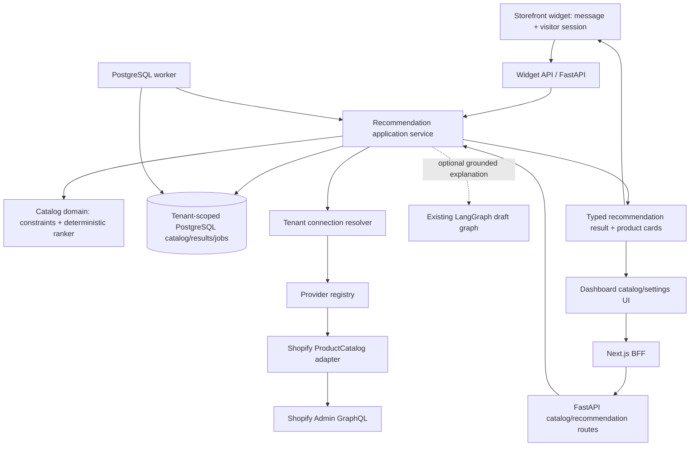

# SupportPilot AI Product Recommendations — Audit and Implementation Plan

**Phase:** 0 audit and plan; Phase 1 implementation record appended below  
**Audited:** 2026-11-01  
**Phase 0 status:** Complete. **Phase 1 implementation:** Present in the repository; PostgreSQL integration acceptance remains pending an isolated test database.

## Executive summary

SupportPilot is a FastAPI/SQLAlchemy modular monolith with a Next.js dashboard and BFF, PostgreSQL with forced tenant RLS, Redis for rate limiting, and a separately run PostgreSQL-polling worker. Its storefront widget is a standalone JavaScript asset isolated in a Shadow DOM. It already persists visitor conversations, has a grounded LangGraph draft graph, retrieves tenant knowledge, and performs authorized Shopify order lookup after email OTP verification.

There is no product catalog model, product synchronization, Shopify product query, product recommendation service, product card API, or recommendation setting/analytics today. Shopify authorization currently requests `read_orders` and `read_customers`; the product API requires `read_products`, which is not part of the current required scope set. Shopify's product query is designed for paginated catalog browsing, filtering, and recommendation use cases. Scope and API-version behavior must be verified against the app configuration before Phase 1 changes. See Shopify's [Product object](https://shopify.dev/docs/api/admin-graphql/latest/objects/product), [`products` query](https://shopify.dev/docs/api/admin-graphql/latest/queries/products), and [access-scope guide](https://shopify.dev/docs/api/admin-rest/usage/access-scopes).

The recommended implementation is a provider-independent catalog and recommendation domain, backed initially by a tenant-scoped Shopify catalog snapshot. Use the existing provider/capability, integration connection, PostgreSQL transaction, and durable worker patterns. Keep candidate filtering and ranking deterministic; use the existing AI provider only to explain verified candidate facts when useful. The shopper must receive typed product cards from verified catalog rows, not free-form model-invented products.

## Current architecture findings

### 1. Backend framework, modules, and dependency injection

- FastAPI application and route registration: `backend/app/main.py`, `backend/app/api/router.py`, `backend/app/api/routes/`.
- Async SQLAlchemy 2.x models and repositories: `backend/app/models/`, `backend/app/repositories/`; Alembic migrations live in `backend/migrations/versions/`.
- Routes use FastAPI `Depends(get_db)`, `Depends(get_current_user)` or role guards from `backend/app/api/deps.py`. Small service factories are usually local to the route module; business logic lives in `backend/app/services/` or the provider package. The worker creates `SessionLocal` sessions directly and sets tenant context explicitly.
- Integrations are being organized under `backend/app/integrations/{core,providers,connections,credentials}`. Core already contains provider descriptors, capability protocols, a duplicate-safe registry, capability enum, and safe integration errors. `CommerceCapability` presently represents order listing and authorized order lookup. The registry is initialized empty at app startup; Shopify is not currently registered as a provider.
- The older Shopify HTTP orchestration remains in `backend/app/api/routes/integrations.py`; widget-specific workflows are in `backend/app/api/routes/widgets.py`. Both route modules contain substantial workflow logic and are natural future refactor candidates, but the recommendation work should avoid a broad rewrite.

### 2. Frontend, widget, and shared UI

- Dashboard: Next.js App Router, TypeScript, feature-oriented modules under `frontend/src/features/`, shared components under `frontend/src/components/`, and transport/BFF code under `frontend/src/lib/` and `frontend/src/app/api/`.
- The dashboard talks through `frontend/src/app/api/[...path]/route.ts`; the BFF forwards tenant requests to FastAPI and owns HttpOnly tenant session cookies.
- The storefront widget is not a React app. `frontend/public/supportpilot-widget.js` is a self-contained JavaScript embed that mounts a custom host with a closed Shadow DOM, responsive panel, quick actions, progressive verification cards, message composer, visitor session storage, and polling. It proxies through `frontend/src/app/api/widget/[...path]/route.ts` and calls the public widget endpoints.
- Existing shared UI primitives include `Panel`, `Button`, `Input`, `Textarea`, and form-field components. The widget has its own CSS and DOM component functions inside the asset; recommendation cards should follow that isolated widget styling and use semantic buttons/links and accessible labels.
- There is no product card component or product-specific frontend API/type module. The Next.js API type generation is based on FastAPI OpenAPI (`frontend/src/lib/api/generated.ts`).

### 3. Shopify integration, scopes, APIs, webhooks, and sync

- Shopify OAuth/client/order/action implementations are under `backend/app/integrations/providers/shopify/`; compatibility imports remain under `backend/app/services/shopify_*`.
- OAuth and configured-store development authentication are implemented in `backend/app/api/routes/integrations.py`. Encrypted credentials are persisted through the legacy `ShopifyInstallation` model and mirrored into generic `IntegrationConnection` / `IntegrationCredential` rows during the compatibility period.
- Current required Shopify scopes are exactly `read_orders` and `read_customers` (`backend/app/integrations/providers/shopify/security.py`). Product data is not requested. Current GraphQL client queries orders, not products. No product endpoints, product webhook receiver, or catalog sync are present.
- There is no implemented webhook/event ingestion service or provider sync worker. The integration synchronization protocol is only a contract; it is not evidence that Shopify synchronization works.
- Shopify's official GraphQL documentation says `products` is paginated and supports product catalog/recommendation use cases and requires `read_products`. Publication-specific fields can have additional scope requirements. Before implementation, confirm the merchant approval workflow, granted scope response, protected data implications, and fields supported by the repository's configured API version (`2026-10`). Do not assume a scope change automatically updates an already-installed app.

### 4. Database, migrations, and tenant isolation

- PostgreSQL is used with SQLAlchemy async sessions and Alembic. The migration chain currently ends at `0024_normalized_messages`.
- Tenant identity is derived from the authenticated user or the validated widget configuration/session. `set_tenant_context` sets transaction-local `app.current_tenant`; tenant repository queries also include explicit organization filters. Tenant-owned tables use forced row-level security, with composite foreign keys on important cross-entity relationships.
- Existing relevant records: `Customer`, `Ticket`, `Conversation`, `Message`, `SupportWidget`, Shopify installation/connection/credentials, `KnowledgeDocument`, `DocumentChunk`, and `AIExecution`. `Ticket.source` supports `shopify_widget`. Conversations and messages already have provider identity/delivery extension columns from migration `0024`.
- New catalog and recommendation records must carry `organization_id`, use RLS and explicit tenant predicates, and use composite uniqueness/FKs so an item, connection, variant, job, result, or event cannot cross organizations. Migration steps should be additive and preserve Shopify data.

### 5. AI orchestration, provider abstraction, tools, and RAG

- `backend/app/services/ai_execution.py` builds a real LangGraph `StateGraph` with prompt preparation and draft generation nodes. It uses a configurable OpenAI-compatible Chat Completions endpoint, bounded output, timeout, safe provider errors, and a PostgreSQL LangGraph checkpointer. Checkpoint `thread_id`s are tenant-prefixed and the checkpoint schema uses RLS.
- This graph is a grounded drafting graph, not a general tool-calling agent: it has no product search node, no Shopify product tool, and no general LLM tool execution. Existing verified-order context is resolved in server-side worker code before the prompt; it is not obtained from model-supplied order/customer identities.
- `backend/app/services/ai_worker.py` retrieves up to six matching chunks from ready, non-deleted tenant knowledge documents using PostgreSQL full-text search and records citations/tool outcomes. `backend/app/services/widget_ai.py` handles deterministic greetings, clarifications, sensitive-request routing, order verification, and missing-knowledge behavior.
- Recommendation selection should be a deterministic domain service with explicit hard constraints. The LLM may produce a short explanation only from selected normalized product facts. The LLM must not invent products, IDs, prices, availability, claims, or links, nor bypass tenant/provider authorization.

### 6. Conversation/session persistence, streaming, and contracts

- Customer messages, assistant replies, agent replies, and internal notes are persisted in `Message`; conversations and tickets are tenant-owned relational records. The widget creates ticket/conversation/first message atomically and uses idempotency keys for first and subsequent visitor messages.
- Visitor sessions are short-lived signed tokens scoped to one widget/conversation; the widget stores session data in `sessionStorage`. Order privacy uses an email OTP flow, and typed email is not treated as identity proof.
- The widget retrieves message history by polling. No streaming or WebSocket transport is implemented. API schemas are Pydantic models; generated frontend wire types come from OpenAPI.
- Product recommendations need a typed and persisted response contract that can be replayed when the widget reloads. Do not rely only on transient browser state or reconstruct recommendations from arbitrary assistant prose.

### 7. Background jobs, cache, logs, monitoring, and errors

- Knowledge ingestion, AI executions, and commerce actions use PostgreSQL job/action rows claimed with row locks/`SKIP LOCKED`, leases, attempt limits, and retry timing in `backend/app/worker.py` and service worker modules. This is the established durable-job pattern. Redis currently backs rate limits rather than durable jobs or catalog caching.
- Shopify logs use structured events and redact tokens/secrets; AI worker failures record safe codes and avoid prompts/provider response bodies. FastAPI returns RFC 9457-style Problem Details with an application code. There is no product-specific monitoring, recommendation event pipeline, or operational metrics backend.
- Catalog sync should use durable jobs and bounded retries, safe error categories, and observable last-success/last-error state. Do not log raw product payloads, customer prompts containing PII, access tokens, or full GraphQL variables.

### 8. Tests, CI, and quality tools

- Backend tests include mocked Shopify API/unit tests, PostgreSQL-backed Shopify/widget/AI/tenant workflows, RLS/runtime-role checks, health checks, and OpenAPI contract checks. PostgreSQL integration files skip when `TEST_DATABASE_URL` is absent; CI sets it and provisions separate migration/runtime roles before applying migrations.
- GitHub Actions (`.github/workflows/ci.yml`) runs backend Ruff, OpenAPI checks, migrations, runtime-role/RLS checks, and pytest. The frontend job runs ESLint, TypeScript, Vitest, generated API type drift check, and production build. A separate E2E job provisions PostgreSQL/Redis and runs Playwright with Chromium.
- Existing focused tests include `backend/tests/test_shopify_orders_unit.py`, `test_shopify_integration.py`, `test_widget_integration.py`, `test_ai_unit.py`, and `test_ai_integration.py`; frontend unit and E2E tests cover integrations, AI, auth, and support workflows. There are no catalog/recommendation tests yet.
- This audit did not run the project test suites. A phase is not complete until its relevant tests run successfully against the intended database and browser environment.

### 9. Reusable code and technical debt

**Reuse:** `IntegrationRegistry` and capability contracts; Shopify GraphQL transport/error/redaction helpers; tenant-scoped integration connection resolution; FastAPI dependency/role patterns; async SQLAlchemy and RLS helpers; existing worker lease/retry approach; `SupportWidget` configuration; the widget's Shadow DOM and polling; `AIExecution`/LangGraph checkpoint infrastructure; knowledge grounding and citations; OpenAPI type generation; existing button/panel/accessibility patterns.

**Modify when the approved phase arrives:** add a typed product-catalog capability/DTO; add Shopify product page mapping; add catalog persistence and durable sync; add a deterministic recommendation application/domain service; extend the widget configuration, API response/history, and widget card rendering; expose protected tenant catalog/recommendation APIs; add safe recommendation analytics and tests.

**Leave unchanged:** tenant authentication/session boundaries, Shopify order verification/OTP, order cancellation approval state machine, public-widget origin checks and visitor-token scope, existing inbox/ticket/message workflows, AI provider/checkpoint security, and current order endpoints. Product recommendations must not imply or execute order edits, cancellation, or refunds.

**Observed technical debt relevant to scope:** Shopify routes still orchestrate OAuth and order work rather than delegating entirely to an adapter; legacy and generic connection tables coexist in a one-release transition; Shopify is not yet registered in the generic registry; public widget asset combines DOM, transport, polling, and workflow presentation in one file; generic synchronization/webhook protocols exist without a concrete provider flow. Address only the pieces required by the approved recommendation phase.

## Proposed architecture

### Repository-adapted folder structure

Use current `app/` conventions and add only populated folders:

```text
backend/app/
  catalog/
    domain/                 # normalized Product, Variant, constraints, ranking
    application/            # sync/use-case orchestration and recommend_products
    infrastructure/         # catalog repositories and Shopify DTO mapping
  integrations/
    core/interfaces/        # add product-catalog capability contract
    providers/shopify/      # paginated GraphQL product reader
    connections/            # resolve the active tenant's authorized connection
  api/routes/
    catalog.py              # authenticated catalog and sync status endpoints
    recommendations.py      # authenticated/team recommendation endpoints if needed
  models/                   # catalog products, variants, jobs, recommendation results/events
  schemas/                  # Pydantic request/response wire contracts
  services/                 # thin compatibility/use-case wiring only if consistent
  worker.py                 # dispatch catalog-sync job kind through existing worker loop

frontend/src/features/
  recommendations/
    api/ components/ hooks/ types/ utils/ tests/

frontend/public/supportpilot-widget.js  # render typed, safe product cards in Shadow DOM
```

Do not add empty provider directories, a second queue, a microservice, or a vector database for this feature. Prefer extending the existing database worker and provider registry. Avoid placing ranking logic in FastAPI route handlers or in the widget asset.

### Dependency diagram



The ranking service owns correctness. LangGraph is an optional explanation layer; it does not select unbounded products or call Shopify directly.

## Proposed domain and commerce contracts

### Catalog domain

Normalize only facts the recommendation flow needs: provider and connection identity, external product/variant IDs, title, plain-text description, vendor/type, tags/options, canonical product URL, image URL, variant price/currency, variant availability signal, Shopify product status, provider `updated_at`, and local `synced_at`. Keep prices in decimal/numeric form with explicit currency. Treat descriptions, tags, and metafields as untrusted text. Do not store customer/order data in the catalog.

### Provider contract

Add a distinct typed product-catalog capability instead of growing order methods into generic recommendation logic. It should expose bounded cursor pagination and normalized read-only product/variant DTOs. It must accept an authorized `IntegrationConnectionRef`; it must never accept a browser-supplied organization ID, shop domain, or token. Shopify adapter handles GraphQL syntax, scope errors, pagination, rate limits, and mapping. Keep GraphQL objects out of domain/application code.

The provider can report capability unavailable when the merchant has not granted product access. The registry must advertise the capability only after the concrete Shopify product reader exists and is tested. A non-Shopify provider can implement the same DTO contract later.

## API contracts (proposed; wire fields snake_case)

All endpoints remain under `/api/v1`, return Problem Details on failure, and derive tenant identity from a workspace session or validated widget visitor session.

| Endpoint | Purpose and access |
| --- | --- |
| `GET /catalog/products?query=&availability=&limit=&cursor=` | Bounded tenant catalog browsing for authorized workspace users; no cross-tenant provider IDs accepted. |
| `GET /catalog/status` | Read-only sync/access status: provider, connection status, granted capability, last sync, catalog count, safe last error code. |
| `POST /catalog/sync` | Owner/Admin starts an idempotent sync or requests reprocessing; returns job ID/state, never blocks on full-store import. |
| `GET /catalog/sync-jobs/{job_id}` | Tenant-scoped job status and safe error details. |
| `POST /widget/conversations/{conversation_id}/recommendations` | Optional explicit recommendation request under the existing visitor token and origin policy; server reads the persisted thread, not client-submitted transcript. |
| `GET /widget/conversations/{conversation_id}` | Extend current persisted history contract with typed recommendation cards/results linked to assistant messages. |
| `POST /recommendations/{recommendation_id}/events` | Optional bounded event action such as impression/click, scoped to authorized tenant or visitor session; idempotent and privacy-minimized. |

Recommendation result wire shape should include `recommendation_id`, `status`, `items`, and a short grounded `explanation`. Each item should contain stable local product/variant IDs, title, variant label, price and currency, availability wording with freshness timestamp, safe image/product URL, and a short reason tied to catalog facts. Do not return Shopify tokens, raw GraphQL responses, internal ranking features, hidden customer PII, or unsupported stock/delivery promises. Validate links as HTTPS and allowed merchant/store destinations before rendering.

## Recommendation workflow

1. **Connect and authorize:** Owner/Admin explicitly grants the minimum required Shopify product access. Backend resolves connection using authenticated organization and checks active status/effective scopes on every sync or provider operation.
2. **Sync catalog:** a durable job fetches pages in bounded batches, upserts product/variant snapshots idempotently, updates cursor/last-sync state, and marks products no longer returned as unavailable/archived only after a completed consistent sync. Failed partial syncs must not wipe current good data.
3. **Detect intent cheaply:** deterministic rules identify recommendation requests and extract optional constraints (category, use, size/color, price range, recipient). Ambiguity asks a concise follow-up. Do not call an LLM for every incoming message.
4. **Apply hard filters:** remove inactive/unavailable items according to explicit merchant policy; enforce requested price ceiling, variant option, and product type before ranking. If relevant facts are absent/stale, ask or return no result instead of guessing.
5. **Rank candidates:** deterministic, unit-testable scoring based on matching the shopper's explicit preferences and catalog metadata. Stable tie-breaking and maximum result count are required. Do not personalize from order/customer history unless a later consented feature explicitly approves that data use.
6. **Explain and render:** optionally ask the existing LangGraph generation stage for one concise explanation grounded only in selected product facts. Persist selected local IDs and structured facts/result status. Widget renders safe, accessible product cards in Shadow DOM; cards link to the merchant product page.
7. **Record feedback:** record bounded impression/click/feedback events for aggregate merchant analytics. Do not infer a purchase conversion without a verified provider event or order association.

## Database changes (future implementation)

Add an additive migration only after approval. Candidate tables:

- `catalog_products`: organization, provider/connection, external product ID, title, sanitized text fields, vendor/type/tags, handle/product URL, image URL, provider status, source timestamps, synced timestamp, and soft-delete/archive state. Unique `(organization_id, connection_id, external_product_id)`.
- `catalog_variants`: organization/product relationship, external variant ID, title/options, SKU only if needed, numeric price/currency, explicit availability signal, and sync timestamp. Unique by tenant/connection/external variant ID.
- `catalog_sync_jobs`: tenant/connection, bounded cursor, status, attempt count/max, next attempt, start/completion, safe error code, and lease metadata. Use queued/running/succeeded/failed/cancelled states and idempotent upserts.
- `recommendation_results`: tenant, conversation/source message, result state, chosen local product/variant IDs or immutable safe display snapshot, ranker version, catalog freshness, and timestamps. Avoid storing full prompt or unnecessary transcript.
- `recommendation_events`: tenant/result/item, event type, event time, safe source channel and dedupe key; no customer email or raw identity unless a separately approved analytics requirement needs it.

All tenant-owned rows need forced RLS and inclusion in `backend/scripts/assert_runtime_db_role.py` policy inventory. Add composite FKs tying product/variant/job/result/event to the same organization and connection. Index tenant+provider ID, tenant+status, tenant+updated time, and recommendation history access patterns based on measured queries. Validate existing records before adding constraints; do not delete or silently reassign records.

## Error handling and security

- Use stable safe categories: `catalog_not_connected`, `product_scope_missing`, `provider_reauthorization_required`, `provider_rate_limited`, `provider_unavailable`, `catalog_sync_incomplete`, `catalog_stale`, `no_matching_products`, and `invalid_product_data`. Return a retryable flag only where appropriate; never expose provider response bodies or credentials.
- Retry transient Shopify/network failures with bounded exponential backoff and jitter; do not retry authorization/scope/validation failures indefinitely. Preserve the last successful snapshot after failed syncs and clearly mark its age.
- Keep tenant resolution server-side. Public widget ID and `Origin` are locators/installation checks, not authentication. Continue validating visitor JWT scope, allowed storefront origin, rate limits, honeypot, idempotency, payload size, and conversation ownership.
- Product recommendations are public catalog data only. Do not reveal customer records, orders, purchase histories, or private inventory details. Do not accept typed email/order number as proof of identity.
- Parse and normalize GraphQL responses at the adapter boundary; validate IDs, URLs, text sizes, prices, currency, variants, and pagination cursors. Escape all product text; no untrusted HTML. Prevent prompt injection from catalog descriptions/tags.
- No model-produced SQL, provider arguments, direct Shopify tool execution, or mutations. Revalidate product status/availability before presenting if the snapshot is stale. Never claim exact inventory or delivery times unless the selected API fields and merchant policy explicitly support them.
- Log request IDs, tenant-safe connection ID, safe provider error code, page count, duration, and result count only. Redact tokens and avoid raw GraphQL variables/product bodies.

## Migration, rollout, and rollback

1. Confirm Shopify app distribution model, development store, API version support, requested/effective scopes, and whether publication or inventory fields need additional scopes. Test installation/re-consent on a disposable development store.
2. Implement and test product DTO/provider reads without changing customer-facing behavior.
3. Add additive catalog/job/result schema and forced RLS, then migrate with the privileged migration role. Verify backfill is not needed for existing order data and runtime app role remains non-superuser.
4. Enable sync for one opted-in test tenant; compare page counts/unique IDs, verify idempotent reruns and partial-failure preservation. Keep old Shopify order paths unchanged.
5. Enable recommendation endpoints and dashboard view behind tenant configuration. Start with agent-facing preview before customer widget display; canary a single development tenant.
6. Enable widget cards only after API contract, privacy, freshness, accessibility, and abuse tests pass. Track feature flag/config per tenant.

Rollback before customer-facing enablement by disabling the feature/config and stopping catalog jobs. Keep catalog snapshots and job/result audit rows; they are additive and can remain unused. If a schema rollback is needed, first stop readers/workers, export or retain operational history, and use a reviewed down migration. Do not drop Shopify's existing tables, connection rows, or credentials as part of this feature. Scope revocation should degrade to safe unavailable behavior and preserve catalog records as stale, not erase merchant data.

## Phase-by-phase implementation checklist

### Phase 0 — Audit and plan (this document)

- [x] Read repository guidance and inspect existing backend/frontend/integration/data/AI/job/test conventions.
- [x] Verify Shopify product API and scope requirements from official developer documentation.
- [x] Document reuse map, absent capabilities, proposed contracts, security boundaries, migrations, and test gates.
- [x] Stop before implementation and wait for approval.

### Phase 1 — Scope confirmation and typed catalog capability

- [ ] Confirm product data fields, supported markets/currencies, variant requirements, out-of-stock policy, stale-data UX, and product link destination policy.
- [ ] Approve Shopify product scope and app re-consent flow; verify current configured API version against official schema.
- [ ] Add provider-neutral product/variant/page DTOs and a product-catalog capability; do not register Shopify until its implementation is complete.
- [ ] Add mocked GraphQL mapping, pagination, malformed response, scope denial, rate limit, and credential-redaction tests.
- **Acceptance:** API client can fetch bounded products with no frontend token exposure; order integration contracts remain unchanged.

### Phase 2 — Tenant catalog projection and durable sync

- [ ] Add additive product, variant, and sync-job tables with RLS, same-tenant composite constraints, indexes, and runtime-role inventory checks.
- [ ] Implement idempotent full/incremental sync, bounded retries, stale/failed states, safe reprocessing, cursor persistence, and partial-failure protection using the existing worker runtime.
- [ ] Add catalog status/list and protected sync endpoints, role rules, API contract/OpenAPI generation, and audit-safe logs.
- [ ] Add PostgreSQL-backed migration, RLS, cross-tenant FK, duplicate upsert, concurrent claim, retry, and large-page tests.
- **Acceptance:** one tenant can sync and browse its own catalog; another tenant cannot read or attach those products; repeated sync produces no duplicates.

### Phase 3 — Deterministic recommendation service

- [ ] Add intent/constraint parsing with clarification behavior; keep hard constraints out of LLM decisions.
- [ ] Implement deterministic filtering/ranking, stable ties, caps, freshness handling, variant/currency handling, and safe no-match behavior.
- [ ] Persist typed recommendation results and ranker version; expose tenant-scoped authenticated API contracts.
- [ ] Add unit, API contract, tenant-isolation, stale-product, prompt-injection, price-boundary, and latency/query-bound tests.
- **Acceptance:** every returned item exists in the tenant catalog and satisfies all explicit hard constraints; every reason is supported by returned catalog facts.

### Phase 4 — Widget product cards and conversation integration

- [ ] Add widget recommendation response/history contract and a card renderer isolated in the existing Shadow DOM asset.
- [ ] Preserve visitor session/origin checks and existing order OTP flow. Recommendation requests must not grant access to order/customer data.
- [ ] Add graceful empty/error/loading states, keyboard/screen-reader behavior, reduced motion, mobile layout, and safe outbound links.
- [ ] Add widget integration tests and Playwright flows for recommendation, clarification, no-match, unavailability, repeated messages, and tenant isolation.
- **Acceptance:** a storefront visitor gets only verified catalog cards; widget retries/history do not duplicate jobs/results; sensitive order questions still use existing verification/handoff.

### Phase 5 — Merchant controls, analytics, and operations

- [ ] Add Owner/Admin settings for enabling recommendations, permitted catalog availability policy, result limit, and any approved explanation behavior.
- [ ] Add deduplicated impression/click/feedback events and real tenant aggregates; do not claim conversion attribution without order evidence.
- [ ] Add safe operational status for last sync, stale catalog, failures, retry, and reprocess; do not expose credentials or raw payloads.
- [ ] Add role, retention, performance, accessibility, and aggregate-isolation tests; document support/runbook behavior.
- **Acceptance:** settings are tenant scoped; analytics are derived from persisted events; operators can diagnose/retry without secrets or cross-tenant visibility.

## Open questions and blockers before Phase 1

1. Which product fields should be captured and shown (especially SKU, inventory counts, publication/market availability, compare-at price, variants, and images)?
2. Should recommendations exclude unavailable items strictly, or may they show unavailable items with clear labels? What is the acceptable catalog staleness window?
3. Is `read_products` acceptable for the Shopify app, and should catalog sync be opt-in per tenant? Verify all additional scope requirements for the chosen fields in the configured API version.
4. Should MVP recommendations be customer-facing immediately, or first appear as an agent preview in the inbox?
5. What product-click and outcome analytics are needed, and what customer-consent/retention rules apply?
6. Does the app need generic provider abstraction in Phase 1, or is a Shopify adapter behind a narrow product-catalog contract sufficient until a second commerce provider exists?

These decisions were implementation planning questions for the later recommendation and storefront phases. They do not block the catalog foundation. Phase 1 choices implemented so far: product and variant records retain title/description/vendor/type/images/online-store URL and per-variant exact price/currency/availability; Shopify inventory quantity is left unknown because inventory scopes were not requested; links are retained only when Shopify returns an HTTPS canonical URL. Recommendation availability policy and staleness thresholds remain open for the future ranking/UI phases.

## Phase 1 implementation record (2026-11-01)

This record captures the concrete catalog foundation, not recommendation ranking or UI. The work is implemented locally; database-backed acceptance is still pending.

- Provider-neutral typed contracts support product pages, product/variant reads, direct current variant price, availability, and provider search. Cart and checkout are separate optional capabilities. Shopify advertises only its implemented product catalog capability.
- Shopify GraphQL product reads and mapping are isolated under `backend/app/integrations/providers/shopify/`. New OAuth installations request `read_products` alongside the existing scopes. The existing order/customer requirements remain unchanged; existing stores must reauthorize to grant product access.
- Additive migration `0025_commerce_catalog` creates normalized tenant-owned products and variants, durable sync jobs, and webhook event records, with numeric variant-level prices, soft deletes, indexes, composite tenant foreign keys, and forced RLS.
- Authenticated endpoints provide catalog status, product list/detail, sync initiation, and job status. Shopify product webhook deliveries are raw-body HMAC checked, store-domain checked, size bounded, deduplicated, and queued without storing raw payload data.
- Shopify product webhook topics are handled at `POST /api/v1/integrations/shopify/webhooks/catalog/{organization_id}/{connection_id}`. The Shopify app/store configuration must subscribe `products/create`, `products/update`, and `products/delete` to that tenant/connection-specific HTTPS URL using the same app client secret. Subscription creation is not automated in this phase.
- The existing database worker handles bounded page synchronization, cursor persistence, transient retry with capped exponential backoff and jitter, failed terminal states, product tombstones, webhook upserts/deletes, and daily full reconciliation. Incomplete full syncs do not tombstone the last good catalog.
- No recommendation ranking, widget changes, cart creation, or Shopify order mutations were added.

### Phase 1 validation record

- Backend Ruff: passed.
- Backend unit suite: 110 passed. PostgreSQL integration cases are skipped locally because `TEST_DATABASE_URL` is unset.
- Alembic chain through `0025_commerce_catalog`: rendered successfully in offline SQL mode. Live migration, RLS, cross-tenant foreign-key, duplicate-webhook, price-update, deletion, and partial-sync tests still need execution against isolated PostgreSQL.
- OpenAPI export/drift and generated TypeScript API type checks: passed.
- Frontend lint, typecheck, Vitest, and production build: passed; there were no frontend feature changes.
- No live Shopify store sync was performed. Reauthorization for `read_products`, configured API-version compatibility, webhook subscription configuration, and real-store pagination remain to be verified.

## Phase 5 commerce workflow record (2026-11-01)

- Product comparison now supports two to four distinct products from the latest tenant-scoped recommendation set. It displays missing specifications explicitly, normalizes a bounded set of unambiguous units (battery capacity, storage, mass, and length), and states trade-offs using saved product priorities without claiming that a higher numeric specification is always better.
- The widget provides multi-select comparison controls, preserves the selected eligible variant, and the API validates that each selected product/variant was recently displayed in that conversation. Stale, cross-tenant, or arbitrary selections are rejected.
- Alternative requests and product rejections exclude the relevant displayed products and rerun the same tenant catalog filters. Existing strict budgets and required features remain unchanged; when no alternatives satisfy them, the assistant asks which constraint the shopper would consider relaxing.
- Shopify currently registers only product-catalog capability. No cart/checkout provider, authoritative variant price-and-stock recheck, merchant upsell controls, or explicit product-compatibility records exist. Therefore cart, upsell, and cross-sell actions remain unavailable; category similarity is not treated as compatibility. No purchase, order, or other consequential action is executed.
- Validation is local and does not include live Shopify stock verification. PostgreSQL-backed tenant integration tests require `TEST_DATABASE_URL`; browser E2E requires the Playwright Chromium executable. Those environment-dependent acceptance checks remain outstanding.

## Phase 6 merchant settings and analytics record (2026-11-01)

- `GET/PUT /api/v1/recommendation-settings` stores one validated policy per authenticated organization. Only Owners/Admins may update; all workspace roles can read. The policy controls enabled state, automatic/explicit intent handling, max results, in-stock filtering, product/collection exclusions, comparison/upsell/cross-sell toggles, ranking weights, and handoff thresholds. Product exclusion IDs are verified against the caller's tenant catalog.
- The storefront recommendation workflow applies enabled/mode, result-count, inventory, exclusion, ranking, comparison, and handoff policy. Collection exclusions apply only when synchronized product metadata includes `collection_ids`. Upsell/cross-sell flags are persisted but remain inactive because no verified compatibility graph/cart provider exists.
- `recommendation_events` is a tenant-owned, indexed, forced-RLS event ledger with unique `(organization_id, event_id)` idempotency. Widget visitors can record only viewable recommendation impressions, detail clicks, comparisons, and rejections tied to assistant messages and listed product/variant IDs. Server workers record no-result categories and shopping handoffs. Raw customer query text and identity are not stored in analytics. Events cascade with their tenant-owned conversation/message/product records; catalog deletions normally remain soft tombstones.
- `GET /api/v1/analytics/recommendations` aggregates daily funnel events, product leaders, no-result categories, recommendation AI token use/cost, failures, and generation latency. The dashboard shows an explicit unavailable state for carts/purchases until an authoritative commerce outcome source is connected; it does not infer purchases from clicks.
- Future attribution policy is a 7-day window: **direct** means a trusted purchase event is linked to the same product/variant after a recommendation product click; **assisted** means a trusted purchase follows an impression or comparison in the window without a matching product click. The current API returns conversion fields as `null` and `conversion_tracking_available=false`, because Shopify purchase webhooks/customer consent and secure order-to-session linkage are not implemented.
- Additive migration `0028_recommendation_settings_analytics` adds tenant policy and event tables, indexes, constraints, and tenant RLS. Downgrade refuses to delete analytics rows. Live migration/RLS and cross-tenant integration coverage require an isolated PostgreSQL `TEST_DATABASE_URL` and were not verified as part of this local phase.
