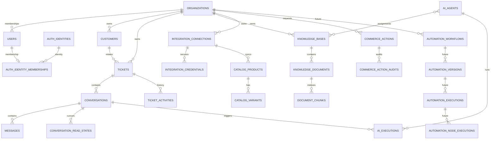

# SupportPilot AI v2.0 — Repository-Grounded Product and Engineering Roadmap

**Status:** Planning plus local implementation slices are in progress. Automation’s constrained canvas has passed local backend, PostgreSQL, frontend, and focused browser checks; graph branching and overall release gates remain incomplete.  
**Reviewed:** 2026-11-06  
**Scope:** Product roadmap and release sequencing for the existing SupportPilot AI modular monolith. This document is not evidence that locally implemented work has been released or verified in a live environment.

## Execution checkpoint — 2026-11-05

- Phase 4 was inspected first because the multi-knowledge-base/bot migration is already present locally and is a prerequisite for trustworthy bot routing. Offline Alembic SQL rendering succeeded; the affected PostgreSQL integration tests were skipped because `TEST_DATABASE_URL` is unset. No Docker commands were run, honoring the existing request to avoid Docker restarts. RLS, data backfill, upgrade, and rollback remain unverified.
- Phase 1 has an implementation slice: dashboard navigation is now grouped by Workspace, AI Studio, Connections, and Administration; route metadata and active-link matching are centralized; Settings keeps its role-aware label; the persisted collapse behavior remains; Security is not a standalone sidebar entry. Added desktop collapse/route-persistence and mobile drawer Playwright coverage with an axe check.
- Validation for the navigation slice: focused Vitest 3/3 passed; full frontend Vitest 42/42 passed; ESLint, TypeScript, and production build passed. Full backend pytest reported 245 passed and 49 skipped, with three existing SQLAlchemy relationship warnings. Playwright could not launch because its Chromium executable is not installed (`chrome-headless-shell` missing); Phase 1 remains in progress until browser/E2E and accessibility checks run.
- Preserve the existing dirty multi-knowledge-base worktree; no unrelated existing changes were reset or overwritten.

## Execution checkpoint — 2026-11-06

- Applied Alembic migrations through `0038_automation_foundation` on a fresh disposable local PostgreSQL 16 cluster; no Docker commands were run. The runtime role preflight passed for `supportpilot_app`, confirming forced RLS on 41 tenant tables and read-only access to the migration ledger. This verifies the empty-database migration path; it does not prove a production database backfill or deployment.
- On a data-bearing disposable database, migration `0036` backfilled a synthetic legacy tenant and its document/source/chunk/ingestion history. Downgrade was rejected while a custom base existed; after removing only that synthetic customization, downgrade succeeded and preserved the legacy document and ingestion rows. The database was upgraded back to head.
- Backend validation: Ruff passed; the complete PostgreSQL-backed pytest suite passed (`312 passed`, `146 warnings`); OpenAPI export drift check passed. The suite ran with `CI=1` and an explicit `TEST_DATABASE_URL`, so database integration cases did not silently skip.
- The API-to-worker flow additionally passed against PostgreSQL: create two bases, upload and ingest both documents, select one bot, and prove its answer cites only its assigned base. The focused AI/workflow/migration regression set passed (`3 passed`, `9 warnings`) using the restricted runtime role.
- Inbox API diagnostics now retain a server-generated correlation ID across the Next.js BFF and FastAPI response; proxy connection failures log only correlation ID, method, and error class, and inbox errors display the reference. After this change, full frontend validation passed: ESLint, TypeScript, API type drift, production build, and Vitest (`49 passed` across 20 files). This improves diagnosis but does not reproduce the reported deployed conversation failure; verify the returned reference against the active backend logs before treating that incident as resolved.
- Inbox reliability follow-up: unexpected FastAPI errors now log their correlation ID, method, and route with the exception traceback, so the reference displayed in the inbox can locate the backend failure. The API contract tests passed (`11 passed`), Ruff passed, and dashboard-shell Playwright passed (`4 passed`) including mocked conversation/message failures. The live incident remains unverified pending its actual browser reference and running backend logs.
- Inbox query follow-up: conversation listing now checks ticket ownership without loading unrelated customer/assignee relationships and sorts ties deterministically by conversation ID. The UI includes HTTP status and stable error code with its correlation reference. Frontend formatter tests (3), ESLint, TypeScript, Ruff, and whitespace checks passed; the focused PostgreSQL integration test skipped because `TEST_DATABASE_URL` is not configured. The live failure remains unverified because local app services are offline.
- Multi-knowledge-base UI increment: Owners/Admins can now edit the selected base name and description through the existing update API; base selection exposes its pressed state, and base-list loading has a retry action. Focused Playwright passed (`2 passed`) including the create/edit/upload/bot assignment/cited-answer flow, Viewer read-only controls, and axe checks. Full frontend Vitest passed (`49 passed`), with lint, TypeScript, Ruff, and `git diff --check` passing. Staged database verification and the complete role/accessibility matrix remain open.
- Phase 4 local role/release gate update: reran the full backend suite against a fresh disposable PostgreSQL database provisioned in the same sequence as CI, with `CI=1` and `supportpilot_app`. Migration upgrade to `0039_ai_agent_audit` and the runtime preflight passed; forced RLS was verified on 42 tenant tables and the migration ledger remained read-only. Backend suite: `317 passed, 154 warnings`, with no skipped integration tests. Full frontend checks passed (ESLint, TypeScript, 49 Vitest tests, API type drift, production build); Knowledge/Bot Playwright now covers Owner, Admin, Agent, and Viewer on the tested flows (`4 passed`), including mobile overflow and axe checks. These are local disposable-environment results; staged database/readiness and rollout verification remain open.
- Inbox local regression update: the full PostgreSQL-backed backend suite includes the conversation listing and cross-tenant regression and passed; the Inbox error formatter tests are included in the full `49 passed` frontend unit suite. This verifies local behavior, not the still-unavailable live Inbox incident.
- Inbox follow-up: conversation listing now checks ticket ownership without loading unrelated customer/assignee relationships and sorts conversations deterministically by creation time and ID. The error panel shows HTTP status and stable error code alongside the correlation reference. Frontend formatter tests (3), ESLint, TypeScript, Ruff, and `git diff --check` passed. The focused backend regression is currently skipped because `TEST_DATABASE_URL` is not configured; localhost frontend/backend are offline, so this narrows the query and improves diagnostics but does not yet verify the user's live failure.
- Frontend validation: ESLint, TypeScript, Vitest (`44 passed`), generated API type drift, and production build passed. The focused automation Playwright flow passed (`1 passed`) with its axe assertion. E2E used a fresh local Next.js server on port 3001; the existing service on port 3000 was not used.
- Phase 7 has a constrained automation foundation in the worktree: customer-message triggers, keyword conditions, ticket actions, approval steps, and now persistent AI bot routing for future widget messages. Team routing, branches, scheduled triggers, recursion controls, and general external side effects remain out of scope. Release verification is deferred.
- Phase 4 routing/retrieval regressions: the widget chooses its bot only from authenticated workspace configuration; a visitor-supplied `ai_agent_id` is rejected, public configuration does not expose bot identity/instructions, and a foreign tenant bot cannot be configured. The selected bot ID and config version are persisted on the created conversation and queued widget execution. Retrieval tests cover current assignment removal, archived bases, and inactive bots returning no knowledge or citations. Against a fresh disposable PostgreSQL database at migration head, Knowledge/AI/Widget integration suites passed (`26 passed`, 71 warnings) using the non-superuser runtime role; the expanded assignment/archive/inactive-bot test passed again (`1 passed`) after its addition. Runtime preflight passed with forced RLS on 42 tenant tables and read-only Alembic ledger access; Ruff passed. This closes local routing/retrieval evidence gaps, not staged rollout verification.
- Integration capability increment — implementation is present locally and validation is deferred to the roadmap's final test pass per the requested build-first sequence. Shopify now registers a provider-neutral, read-only commerce adapter alongside catalog and verified webhook capabilities. It resolves credentials only from the matching organization-scoped active connection, checks effective order/customer scopes, paginates order summaries without customer PII, and reuses the verified order lookup for private details. The existing Shopify order-list API now calls the application-scoped registry capability; verified widget order replies use the same capability rather than calling Shopify-specific lookup/token code directly. The Integrations settings card renders only capabilities returned by the backend registry; no future provider is represented as available. Live Shopify requests and the regression suites remain unverified for this increment.
- Automation version rollback increment — implementation is present locally; validation is deferred to the final test pass. Owners/Admins can list bounded immutable published-version metadata and restore an older definition as a new draft. Restore locks the tenant-owned workflow, revalidates assignment targets, advances the draft revision above both current draft and published revisions, and leaves the active published pointer and execution references unchanged. The UI identifies the active version and makes the publish requirement clear. PostgreSQL/API, frontend, and Playwright regression cases are authored but not run in this build-first sequence.
- Phase 8 remains partial. The UI now has a constrained, keyboard- and pointer-operable node canvas for the supported linear workflow, bounded draft undo/redo, safe restore-as-draft, draft validation, expandable execution details, and a separate Owner/Admin approval queue for the supported pause action. Freeform branching and staged release verification remain incomplete.

## Final verification checkpoint — 2026-11-06

- Runtime/migration follow-up (2026-11-06): the running API reported schema drift during an earlier startup attempt. Read-only Compose inspection showed its migration service image did not contain revision `0043_widget_multiple_ai_agents`, while the bind-mounted API source did. The local `migrate` service now mounts `./backend` read-only at `/app`, matching the API/worker source and preventing stale migration code from silently blocking local migration runs. `docker compose config -q` passed; `docker compose run --rm --no-deps migrate` exited 0; the running API reports Alembic `0043_widget_multiple_ai_agents (head)` and `/health/ready` returns HTTP 200 with PostgreSQL and Redis connected. No application services were restarted. This verifies the local stack only; it does not satisfy Phase 4 staged rollout/readiness requirements.

- Completed the requested build-first pass, then ran final validation without starting or restarting Docker. Backend tests used an isolated disposable PostgreSQL 16 cluster on port 55438 with `CI=1`, migrations applied through `0041_automation_canvas_layout`, and the restricted `supportpilot_app` role. The complete suite passed: `342 passed, 180 warnings in 34.50s`; no integration tests were skipped.
- Fixed one test-contract mismatch found by the suite: the widget order lookup test’s mock returned Shopify’s raw GraphQL shape, while the provider-neutral commerce capability returns normalized order fields. The fixture now models the capability contract. Targeted regression passed (`1 passed`), followed by the full suite (`342 passed`).
- Backend Ruff passed (`All checks passed!`). `git diff --check` passed.
- Frontend final checks from this pass: full Vitest (`82 tests passed`), generated OpenAPI type drift check passed, and Next.js production build completed. ESLint and TypeScript checks passed earlier in this same verification cycle. Focused automation and Knowledge/Bot Playwright flows passed (`5 passed` total); focused frontend component tests passed (`12 passed`).
- Automation UI runtime fixes from the browser suite: new condition/action nodes now render with fallback positions before layout updates, the bot audit panel safely handles an empty audit response, and automation section headings meet the axe contrast threshold. The automation mock now reflects current publish/restore version semantics.
- Continued Phase 9/10 verification after adding browser coverage for Settings: Owners can deep-link to Team & roles, navigate by section hash, and persist workspace-name changes through the API; Viewers are confined to account security and do not issue organization/team queries. The Settings axe run found low-contrast category labels (2.54:1); the labels were darkened and the accessibility check now passes. Settings E2E passed (`2 passed`). The automation canvas cleanup also removes render-time ref access; current frontend lint/typecheck, all Vitest tests (`82 passed`), OpenAPI type drift, automation/Settings E2E (`3 passed`), and Next.js production build pass.
- Local checks verify the current implementation against disposable PostgreSQL and mocked/local browser flows. They do not establish staged or production migration state, live external-provider access, broad cross-product accessibility, load/performance targets, or rollout/rollback readiness. Phase 8 remains partial, and the overall v2.0 roadmap remains in progress.
- Phase 10 remains partial. Request-to-job correlation and automation execution metrics exist; centralized dashboards, alerting, performance/load budgets, and broader observability are still open.
- Continuation check after the checkpoint: fixed the automation workspace's `defaultAction` import, normalized optional API canvas coordinates into required editor arrays, and refreshed stale canvas validation tests. Current frontend validation: ESLint passed with one hook-dependency warning; TypeScript passed; Vitest passed (`78 passed`); OpenAPI type drift passed; Next.js production build passed; `git diff --check` passed. The previous 82-test count above is a prior run, not the latest count. Automation Playwright was updated for the current Workflows hub → New workflow flow, but this attempt could not finish: the first run exposed an incomplete mock response (now fixed), and the next Chromium launch hung until Playwright's 180-second browser launch timeout. Do not count this E2E as passing. The earlier Settings-only E2E remains `2 passed`; the last broader suite was `13 passed, 1 failed` before the current test refresh. No Docker commands were run.
- Automation follow-up details: the canvas now uses a bounded fixed node-height estimate, avoiding render-time DOM-ref measurement. The editor's list filtering iterates descriptors without invoking their event callbacks. The focused browser test and complete E2E matrix must be rerun in an environment where Chromium launches reliably before Phase 8/9 browser acceptance is considered current.
- Phase 10 implementation slice (2026-11-06, verification pending): automation health now accepts optional `start_date`/`end_date` while preserving the existing `days` API, applies an inclusive UTC date selection using a half-open database interval, and validates reversed or overlong ranges. The Analytics dashboard passes its date picker values through the query key and endpoint, so all displayed operational metrics now share the selected date range. Added backend integration and frontend interaction assertions; full test pass is deferred to the requested final verification sequence.
- Continued local foundation verification (2026-11-06): normalized and validated knowledge-base and bot names before minimum-length checks, and added a PostgreSQL regression proving the composite assignment foreign key rejects cross-tenant base references. A fresh disposable PostgreSQL 16 database migrated through `0041_automation_canvas_layout`; runtime-role preflight confirmed forced RLS on 42 tenant tables and read-only Alembic ledger access. Focused Knowledge/AI/Widget integration tests passed (`28 passed`), then the full backend suite passed (`351 passed`, no skips). Backend Ruff and OpenAPI export drift passed. Frontend ESLint, TypeScript, Vitest (`78 passed`), generated API type drift, and Next.js production build passed. With permission to run the local listener, a serial Playwright acceptance set passed (`12 passed`): shell collapse/mobile drawer/title accessibility, Inbox conversation/message diagnostics and actions, Knowledge/Bot setup and role views, and public pages. Auth registration/approval/OTP/password-recovery browser flows still require the API, database, platform owner, and Mailpit services; they were not included in this pass. No Docker commands were run. Staged database state, live provider behavior, and rollout remain unverified.
- Phase 2 revalidation (2026-11-06): recreated a disposable PostgreSQL 16 cluster without Docker, applied migrations through `0041_automation_canvas_layout`, and reran the full backend suite with `CI=1` and the restricted runtime role (`351 passed`, no skipped tests). The preflight again verified forced RLS on 42 tenant tables and a read-only Alembic ledger. The prior serial Playwright set passed (`12 passed`), including Inbox error references, conversation choice, start-thread, reply/note/claim/status actions, and shell navigation. Local checks found no active app or Mailpit services on ports `3000`, `8000`, or `8025`; the reported live Inbox failure therefore remains untraceable to a request log from this workspace session. No changes were made to the user's database or Docker state.

## Execution checkpoint — 2026-11-07

- Phase 7 team-routing implementation is in progress locally. Added tenant-owned support-team, membership, and audit models with migration `0057_tenant_teams`, forced RLS, tenant-aware composite foreign keys, and nullable team routing on tickets. Added Owner/Admin team management APIs and Settings controls; ticket creation, ticket details, bulk updates, and Inbox customer context can route tickets to an active team. Assignees must be active workspace members and, when a ticket has a team, members of that team. Agents can claim tickets routed to their teams.
- This is an implementation checkpoint only. Per the current request, no tests, lint, type checks, migration execution, or Docker commands were run. PostgreSQL migration/RLS behavior, frontend type/build correctness, API contract refresh, and end-to-end team-routing behavior are unverified. Phase 7 and the v2.0 roadmap remain in progress.
- Automation trigger increment (2026-11-07, validation intentionally deferred): `conversation_started` is now accepted by publishing, preview policy, and durable message-event dispatch. It starts exactly once on the first persisted customer message in a conversation and uses a per-conversation event key; dispatch serializes on the conversation row and selects first messages deterministically by `(created_at, id)`. Worker first-message detection uses the same tie-break. It does not synthesize a message when an empty conversation is created. The workflow editor can select this trigger and hides message-only filters for it. No tests, lint, type checks, API export, migrations, or Docker commands were run, so this code remains unverified and Phase 7 stays partial.

## Executive summary

SupportPilot already has a substantial support and commerce foundation: tenant/workspace authentication and approval, tickets, conversations, customers, a ticket-centered inbox, a Shopify storefront widget, grounded AI workflows, document ingestion, Shopify order/catalog integration, recommendation workflows, and PostgreSQL-backed durable jobs. The next program should stabilize and complete these capabilities before expanding the product surface.

The multi-knowledge-base/AI-bot implementation and migrations have now been exercised in a disposable local PostgreSQL environment. Legacy-data backfill, guarded downgrade, document/ingestion-history preservation, restricted-role retrieval, API-to-worker bot-scoped citations, Owner/Admin/Agent/Viewer API authorization, and service-backed browser journeys now have local evidence. The service flow used the restricted runtime role, real FastAPI, PostgreSQL, Redis, and the durable ingestion worker; it created a base, uploaded and processed a document, created a bot assigned to that base, and verified persistence through the API. A Viewer can read these screens but cannot see knowledge/bot configuration controls; backend mutation endpoints reject writes from Agents and Viewers. Deployed database state, the full role/accessibility matrix, live provider behavior, and staged rollout remain unverified; do not treat local verification as a production release.

The largest product gaps in the supplied enterprise roadmap are a general-purpose automation platform and visual builder, production-ready additional messaging channels, granular settings backed by persisted APIs, broad operational analytics, and release-level end-to-end/security verification. These should be introduced incrementally, with real capabilities and tests before the UI advertises them.

## 1. Current repository architecture

| Area | Verified repository shape | Notes and constraints |
|---|---|---|
| Backend API | FastAPI, Pydantic schemas, async SQLAlchemy, Alembic. Feature routers coexist with `backend/app/api/routes` compatibility modules and are assembled in `backend/app/api/router.py`. | Continue migrating by capability where it reduces coupling; do not rename public routes solely to match a proposed tree. |
| Frontend | Next.js App Router, React, TypeScript, Tailwind, shared UI primitives, feature modules under `frontend/src/features`. | Keep each feature's API, types, hooks, components, schemas, and tests colocated. Use existing shared UI before adding dependencies. |
| Data and tenancy | PostgreSQL models under `backend/app/models`, additive Alembic migrations, organization ownership and transaction-local tenant context/RLS. | PostgreSQL-backed checks depend on `TEST_DATABASE_URL`; live migration state is not inferred from files in the repo. |
| AI and retrieval | LangGraph workflows, typed tools, provider gateway, PostgreSQL full-text document retrieval and checkpoint persistence under `backend/app/features/ai`. | The inspected retrieval path is PostgreSQL full-text search. Do not document pgvector as present or add it without a measured need and separate migration plan. |
| Workers | PostgreSQL durable jobs with leases, `SKIP LOCKED`, fair scheduling, bounded timeouts, retries and handlers for AI, catalog, commerce, ingestion, outbound, and maintenance under `backend/app/workers`. | Reuse this system for future workflow execution only after defining job-family fairness, approval, idempotency, and event-loop safeguards. Redis currently supports rate limiting; it is not the durable job queue. |
| Integrations | Provider-neutral capability/contracts, registry, connection and encrypted-credential services, Shopify adapter under `backend/app/integrations`; generic messaging/outbound delivery modules exist. | Shopify is the only verified commerce provider implementation. No implemented WhatsApp, Messenger, Instagram, Telegram, or email transport adapter was found. |
| Current support domain | Organization, users/identities, customers, tickets, conversations, messages, read state, activity, widget, and commerce action models/services exist. | Existing public contracts and transaction boundaries must remain compatible. |
| Current commerce/catalog | Shopify OAuth/configured store connection, encrypted credentials, order lookup, catalog product/variant sync, recommendation services/settings/events, and human-reviewed cancellation actions exist. | Live Shopify behavior, protected-data permissions, catalog freshness, and real cancellation execution require external-store verification; mocked tests do not prove them. Shopify order editing and real refunds are not complete. |
| Current UI surface | Overview, inbox, tickets, customers, analytics, knowledge, AI playground, AI bots, orders, operations/security, settings, widget configuration/preview, platform approval/login, public pages, and a constrained automation builder exist locally. | UI completeness is uneven. Settings is not the full categorized settings system; broader workflow branches and team routing are not implemented. |
| CI and validation | Backend pytest/Ruff/OpenAPI checks and frontend lint/typecheck/unit/generated-contract/build checks exist. Playwright/DB workflows are present in the repo/CI path. | Latest known local evidence is a prior snapshot, not a fresh run in this audit. Prior PostgreSQL tests were skipped when no test DB was available, and browser/CI acceptance had open issues. Re-run for each phase. |

### Existing implementation evidence

- API assembly: `backend/app/api/router.py`
- Core backend features: `backend/app/features/{auth,customers,tickets,conversations,inbox,widgets,analytics}`
- AI orchestration: `backend/app/features/ai/{application,domain,infrastructure,tools,workflows}`
- Provider architecture: `backend/app/integrations/{core,connections,credentials,providers/shopify,messaging}`
- Durable worker: `backend/app/workers/{application,infrastructure,handlers}`
- Domain models: `backend/app/models/`
- Frontend feature modules: `frontend/src/features/`
- Dashboard shell: `frontend/src/components/dashboard-shell.tsx`
- Existing sprint verification tracker: `docs/ui-roadmap.md`
- Existing architecture notes: `docs/architecture/` and `docs/omnichannel-integration-architecture.md`

## 2. Existing and missing feature inventory

| Capability | Current status | v2.0 direction |
|---|---|---|
| Tenant approval, platform-owner separation, shared identity/workspace selection, email OTP | Implemented in code and migrations; live DB and email delivery remain environment-dependent. | Preserve sessions, tenant membership, and platform/workspace boundary; improve security/settings UX only with corresponding APIs. |
| Inbox, messages, notes, ticket assignment/status/activity, customer context | Substantial implementation present. | Stabilize reliability, ensure channel/thread consistency and accessible three-pane behavior before adding more panels or real-time features. |
| Shopify storefront widget and inbound ticket creation | Implemented; live storefront behavior is environment dependent. | Keep public widget configuration non-authoritative, secure visitor sessions, avoid browser-selected tenant/bot identity. |
| AI customer support and human handoff | LangGraph execution, grounded retrieval, draft/human modes, and execution persistence are present. | Complete bot-scoped retrieval and stale-reply/concurrency gates; never permit model to execute protected commerce mutations directly. |
| Knowledge documents/ingestion | Document CRUD/search and durable ingestion are present. | Add/verify multiple bases and bot assignments via current worktree before extending connectors or embeddings. |
| AI bots | Worktree implementation includes management and assignments. | Verify role policy, defaults, activation, conversation routing, and tenant-scoped citations against PostgreSQL. |
| Shopify commerce | Connection, order lookup, catalog sync, product recommendations and approved cancellation path are present. | Fix stale diagnostics and prove live sync; complete previewed order edit and real refund only as separate approved scope. |
| Recommendation engine | Catalog-based extraction/ranking, conversation state, settings/analytics and widget UI are represented. | Validate actual catalog quality, strict-currency/budget behavior, and cart capability before expanding cross-sell or conversion claims. |
| General workflow automation | A constrained user-configurable automation foundation and builder exist locally, including durable execution, approvals, selected AI bot routing, and a new local team-routing foundation. | Verify team routing and continue with branches, schedules, and broader workflow controls only as separately scoped safe capabilities; release gates remain open. |
| Additional messaging channels | Provider-neutral interfaces/outbound primitives exist, but no live channel-specific WhatsApp/Messenger/Instagram/Email adapters were found. | Add providers one at a time after foundation and external credentials/permissions are available. Do not show fake connected states. |
| Settings | A broad workspace settings page, integration/widget settings, and security/operations screens exist. | Reorganize into a searchable settings shell and only add persisted, permission-checked settings. |
| Analytics | AI usage/evaluation and recommendation event analytics exist. | Add support/SLA/channel/workflow metrics only after reliable event definitions and source data exist. |
| Production observability and hardening | Structured logs, health checks, durable retries and some audit paths exist. | Close measurable gaps: trace/correlation IDs, metrics/alerts, failure runbooks, representative load and external-provider verification. |

## 3. Proposed navigation and settings sitemap

Show navigation only for implemented, permission-available capabilities. “Planned” items belong in a roadmap/discover surface, never as misleading active links.

```text
WORKSPACE
  Overview
  Inbox
  Tickets
  Customers
  Analytics

AI STUDIO
  AI Bots
  Knowledge Library
  Automations (only after Phase 7 foundation is usable)
  AI Playground

CONNECTIONS
  Channels (implemented connections only)
  Integrations

ADMINISTRATION
  Settings

FOOTER
  Help
  Profile / sessions
  Theme
```

Security should be a section within Settings, not a duplicate primary sidebar item. Shopify order operations can remain discoverable from Inbox/customer context and the Integrations area; keep the existing order lookup route usable during navigation changes. Sidebar state should remain stable on Inbox routes, collapse responsively, persist preference, expose accessible tooltips, and derive visibility from centralized route/permission metadata.

Settings secondary navigation, phased by real API availability:

```text
Workspace: General, Members & Roles, Teams (future), Business Hours (future), SLA (future)
AI: Bots, Provider/Model, Defaults, Guardrails, Knowledge Retrieval, Handoff, Budget
Communication: Widget, Routing, Notifications (only with event/read API), Saved Replies (future)
Automation: Execution Defaults, Retry Policy, Approval Policy, Limits (as APIs arrive)
Security & Privacy: Authentication, Sessions, Data Retention (future), Audit Logs
Connections: Channels, Integrations
Developer: API Keys, Webhooks, Event Logs (only when implemented)
Account: Usage; Billing only after a real billing backend exists
```

## 4. Design system proposal

- Preserve the existing semantic CSS-variable/light-dark token approach and shared controls. Improve consistency in focused iterations instead of replacing the app shell wholesale.
- Use the existing brand blue for primary actions; reserve semantic tokens for success/warning/danger and a restrained violet AI accent. Do not hardcode the supplied reference hex values in feature components.
- Standardize typography, spacing, content widths, dense data-table rows, form-label/input spacing, small but visible focus indicators, badges, panels, empty/error/loading states, and responsive breakpoints.
- Keep the desktop Inbox three-pane layout and mobile single-panel drill-down. Sidebar collapse must not alter Inbox-specific geometry or hide workspace navigation unexpectedly.
- Honor reduced motion, keyboard/focus order, semantic landmarks, WCAG AA contrast, accessible dialogs/menus, 44px mobile touch targets, and automated axe checks on critical journeys.
- Prefer existing components in `frontend/src/components/ui` and feature-owned components. Add dependencies only when current primitives cannot meet a concrete interaction requirement.
- Use motion only for short state changes; no decorative animation that delays message handling or hides state.

## 5. Proposed backend module boundaries

Continue the current modular monolith. Use `api/application/domain/infrastructure` only where a feature has distinct policies/adapters; do not force every small router into a four-layer structure.

```text
backend/app/features/
  auth/ organizations/ users/ customers/ tickets/ conversations/ inbox/ widgets/
  analytics/ knowledge/ ai/ recommendations/ automations/ channels/
backend/app/integrations/
  core/{interfaces,contracts,registry,errors}
  connections/ credentials/ providers/<provider>/ messaging/
backend/app/workers/
  application/{dispatcher,scheduler,contracts}
  infrastructure/{job_repository,outbox}
  handlers/<job-family>
```

Rules:

1. Routes validate transport input and call feature application services; no route-to-route business imports.
2. Domain policies stay deterministic and provider/LLM independent.
3. Shopify SDK/GraphQL, OAuth, webhooks, and response mapping remain under `integrations/providers/shopify`.
4. Public widget identity can locate a configured widget but does not authenticate tenant selection; trusted widget configuration resolves organization and bot.
5. All tenant data access uses authenticated tenant context plus DB RLS/constraints. Jobs set tenant context before each unit of tenant work.
6. AI and automation tools use typed allow-listed inputs/outputs; model output cannot provide SQL, URLs, or executable workflow code.
7. Reuse PostgreSQL durable jobs and outbound event persistence. No new queue technology without measured evidence.

## 6. Conceptual ERD and current-state mapping

The diagram distinguishes existing entities from later additions. It is a planning ERD, not a migration specification; inspect model constraints and data before every migration.



**Present in inspected models:** organizations/users/auth identities and memberships; tickets/customers/conversations/messages/read state/activity; knowledge documents/chunks/jobs; locally added knowledge bases/agents/assignments; AI executions; integration connections/credentials/events/delivery jobs; catalog products/variants/sync jobs; commerce actions/audits; recommendation settings/events.

**Future only if justified:** teams and team memberships, SLA policies, immutable agent versions, explicit agent tool permission records, general automation workflow/version/execution/node/approval tables, channel-specific identities/health tables, API keys, outgoing webhook endpoints, notification preferences, saved replies, data retention policies, and billing entities. Several channel/provider concerns may be served by existing integration/event/message tables rather than duplicated entities.

For additions, require `organization_id`, same-tenant composite foreign keys where relationships cross tenant-owned records, forced RLS consistent with existing policies, bounded indexes based on query plans, idempotency keys for retried events/actions, and additive migration/backfill/rollback plans. Avoid a table for every UI noun.

## 7. Dependency and release order

```text
Phase 0 audit (complete in this document)
       ↓
Phase 1 design/app shell (small compatible cleanup)
       ↓
Phase 2 support workspace polish ─────┐
       ↓                              │
Phase 3 AI bot management              │
       ↓                              │
Phase 4 knowledge/bot retrieval ───────┘ (must precede new channel routing)
       ↓
Phase 5 channel foundation → Phase 6 integrations surface
       ↓                                  ↓
Phase 7 automation execution foundation (reuse durable workers/outbox)
       ↓
Phase 8 visual builder (only after one real workflow is safe and observable)
       ↓
Phase 9 settings/admin APIs
       ↓
Phase 10 analytics/observability (instrumentation begins earlier; dashboards after metrics)
       ↓
Phase 11 one additional channel at a time
       ↓
Phase 12 optional expansion by separately approved scope
       ↓
Phase 13 release hardening is a gate throughout and final release gate
```

Some cross-cutting work cannot wait until its numbered phase: tenant/security checks, API contracts, structured diagnostics, accessibility, test gates, performance budgets, and feature flags are required in every phase. The sequence is a dependency order, not a claim that all roadmap items must ship in one version.

## 8. Phased implementation roadmap and acceptance

### Phase 0 — Repository audit and product architecture — complete for planning

**Deliverable:** this document. Source inspection only; no application code edits in this phase. Preserve the uncommitted KB/bot implementation as pre-existing local work.

**Gate:** current-vs-target matrix, module boundaries, navigation, conceptual ERD, dependencies, risks, and recommended first implementation are documented. No production feature is declared complete by this audit.

### Phase 1 — Design system and app shell — partial foundation exists

**Reuse:** `frontend/src/components/dashboard-shell.tsx`, `frontend/src/components/ui/*`, global styles, existing sidebar collapse/theme behavior, centralized generated API client and feature layout.

**Scope:** consolidate route/permission metadata, stabilize one persistent shell across routes including Inbox, consistent secondary Settings shell, keyboard and mobile navigation, shared alert/empty/loading/form/table patterns, light/dark tokens and low-contrast focus states.

**Do not:** redesign every page at once or remove existing routes. Keep unavailable navigation hidden or clearly planned.

**Acceptance:** direct navigation and browser refresh work for all current routes; shell does not jump on Inbox; keyboard/mobile layout and axe checks pass; no regression in auth/session flows; frontend lint/typecheck/unit/build pass.

**Dark-theme palette increment (implementation pending final validation):** Extended the existing semantic Tailwind color tokens used by Inbox for focus rings, selected states, customer avatars, and error panels. The Inbox now gets dark-surface variants from the shared theme palette rather than leaving those semantic accents at their light-theme values. No navigation, layout, or API behavior changed. Tests remain deferred to the final validation pass.

**Inbox dark-surface consistency (implemented locally, validation deferred, 2026-11-07):** The Inbox customer avatar now uses semantic light/dark surface tokens instead of fixed beige colors, and dark mode requests the browser's dark native-control palette for selects and other form controls. Existing slate, blue, violet, emerald, amber, and error surface tokens continue to theme transcript, composer, ticket list, and customer-context surfaces consistently. No layout, sidebar, or API behavior changed. No tests or checks were run under the current feature-only instruction.

**Accent contrast and focus sizing (implemented locally, validation deferred, 2026-11-07):** Added a theme-aware foreground token for primary/danger buttons and active Inbox controls so dark mode uses readable text over the lightened accent color. Reduced shared button, select, textarea, and Inbox search focus rings to a compact 2px treatment while retaining a visible keyboard focus indicator. No API or navigation behavior changed; validation remains deferred under the feature-only instruction.

**Persistent Inbox shell at tablet widths (implemented locally, verification deferred):** The shared dashboard shell now keeps a compact 72px navigation rail visible on Inbox from the medium breakpoint, so entering Inbox no longer removes the workspace sidebar at tablet widths. The desktop expanded/collapsed preference remains intact, other pages retain their existing mobile drawer behavior, and narrow phones continue to use the accessible overlay drawer. The Inbox retains its single-panel drill-down below the large breakpoint. No separate Inbox shell or route layout was introduced. Tests were not added or run per the current instruction.

### Phase 2 — Overview and core support workspace — substantial implementation; stabilization first

**Reuse:** existing inbox, ticket/customer/conversation APIs and `frontend/src/features/{inbox,tickets,customers,dashboard}`.

**Scope:** fix conversation/message loading failures from logs and API contracts; preserve server pagination and ticket-to-conversation selection; polish customer context, assignment, status, notes, activity and AI/human mode. Add realtime only if current polling/transport evidence requires it; otherwise bounded polling with visibility pause.

**Progress:** the BFF now forwards correlation IDs so a generic conversation/message request failure can be matched to a FastAPI request log; proxy errors no longer disappear without safe diagnostics. The inbox also now tolerates malformed list payloads from side panels instead of allowing a render exception to hide the conversation error. Playwright confirms conversation and message API failures display their correlation reference; the full dashboard-shell E2E file now passes (`6 passed`), covering these failures, mobile/desktop navigation, the second-conversation choice, and starting a thread. Message history sorts by `(created_at, id)` so equal timestamps remain stable. A PostgreSQL regression test confirms the order under tied timestamps and verifies cross-tenant message reads return 404 (`1 passed` in the previous disposable-PostgreSQL run). Inbox lets agents create a conversation directly when a ticket has no thread, reusing the existing API and opening the composer. On 2026-11-06, local ports 3000 and 8000 refused connections, so the reported live failure could not be reproduced in that session; it remains open until an active browser/backend run supplies a correlation ID and confirms the live tenant's conversation and message loading.

**Message search increment (implementation pending final verification):** Inbox search now includes customer- and agent-visible message content across a ticket’s conversations, in addition to ticket subject/description and customer name/email. It excludes private internal-note bodies, keeps organization and conversation joins tenant-scoped, and escapes SQL `LIKE` wildcard characters so the entered text is treated literally. The existing page size, signed filter-bound cursor, and `(activity_at DESC, ticket_id DESC)` order are unchanged. Tests remain deferred to the final verification pass.

**Inbox filter recovery and count clarity (implemented locally, validation deferred, 2026-11-07):** The ticket list now labels its count as the number of tickets currently shown (with `+` when another page exists), rather than implying that the loaded page is the workspace-wide conversation total. A Clear control appears whenever a filter, search, or unapplied search draft is present; it resets scope/status/priority/search and returns the list to its first page. Validation was not run under the feature-only instruction.

**Channel-aware Inbox filtering (implemented locally, validation deferred, 2026-11-07):** The Inbox can now filter tickets that have at least one conversation from a selected channel, using a tenant-scoped server-side existence check before cursor pagination. The channel participates in the signed cursor fingerprint only when selected, preserving existing unfiltered cursor compatibility. The Analytics response-time channel table links directly to the matching Inbox filter. No migration was needed; OpenAPI and generated TypeScript types were refreshed. Validation is deferred under the feature-only instruction.

**Inbox customer context increment (implementation pending final verification):** The ticket details panel now loads the customer's recent message history through the existing tenant-scoped customer history endpoint. It shows the latest four visible customer/team messages with their ticket, sender, and timestamp, excludes internal notes using the existing API contract, and links to the full customer history when more messages exist. No new API or persistence was added; validation is deferred to the final verification pass.

**Inbox activity timeline increment (implementation pending final verification):** The customer context panel now leads with the five newest ticket events instead of the oldest five and lets agents expand the existing timeline to all events or return to the latest five. It reuses the existing tenant-scoped activity response and adds no API or persistence changes. Validation is deferred under the current implementation-only instruction.

The conversation list now refreshes every 10 seconds while the tab is visible, matching the existing bounded message polling. A lone conversation opens automatically; if polling discovers additional threads, transcript and composer queries stop immediately until the agent explicitly chooses a conversation. The regression E2E case and entire dashboard-shell file pass (`6 passed`); the mocked knowledge/bot browser suite also passes (`4 passed`, including role, mobile, and axe checks). Frontend lint, typecheck, unit tests (`53 passed`), API type drift check, and production build passed for this update.

Additional Inbox acceptance coverage now exercises a successful agent workflow in Playwright: send a reply, add an internal note, claim the ticket, and resolve it. The combined dashboard-shell and Inbox Playwright run passed (`7 passed`). This UI test mocks the API; the corresponding backend behavior and tenant isolation are covered by the PostgreSQL-backed API suite. It does not establish a live browser session against the current workspace's API.

Latest current-worktree audit (2026-11-06): backend pytest passes `329` tests with PostgreSQL enabled against the disposable database and restricted `supportpilot_app` role; no tests skipped. Ruff and OpenAPI export drift pass. Migration `0036` legacy backfill, downgrade preservation, and re-upgrade were exercised on a synthetic tenant; migration head is `0039_ai_agent_audit`. Dashboard-shell Playwright (`6 passed`) and mocked Knowledge/Bot Playwright (`4 passed`) pass with a temporary local Next server. This verifies local disposable-database and mocked-browser behavior; deployed database state, live customer workflows, and staged rollout remain unverified.

**Bulk ticket actions (implementation in progress):** added tenant-scoped atomic bulk updates for status, priority, and (Owner/Admin only) assignment, capped at 100 unique ticket IDs. Tickets are locked in stable ID order, the entire request fails if any ticket is outside the workspace or missing, assignees must be active members of the same tenant, and per-ticket activity records are written in the same transaction. The ticket list now supports selecting rows across the current paginated view and applying those changes. API and generated TypeScript contracts were updated. Tests were intentionally deferred per the current build-first instruction; role, tenant, transaction, and UI regression coverage remain required before acceptance.

**Bulk selection limit clarity (implemented locally, validation deferred, 2026-11-07):** Ticket selection now enforces the backend’s 100-ticket batch maximum across pages before submission. Selecting a page that would exceed the cap is declined as a whole with an explanation, and the toolbar reports the selected count against the limit. This avoids a predictable validation error after users build a large selection across pages; API and persistence behavior are unchanged. No tests were run under the feature-only instruction.

**First-response SLA policy (implemented locally, validation deferred, 2026-11-07):** Added tenant-scoped elapsed-time targets for low, normal, high, and urgent priorities, editable by Owners/Admins under Settings → Inbox & SLAs. Inbox responses now include first-response target, due time, response time, and status (`on_track`, `at_risk`, `overdue`, `met`, or `breached`); ticket cards display a compact SLA badge. Target calculation uses the earliest customer message and first public agent/assistant response across the ticket’s conversations. The additive migration is `0058_first_response_sla_policy`; it has not been applied. OpenAPI and generated frontend contracts were refreshed. No tests, lint, type checks, database migration, Docker, or runtime checks were run per the feature-only instruction.

**Transcript follow-latest behavior (implementation pending final validation):** the conversation pane now opens at the latest message and follows arriving messages while the agent is near the bottom. Scrolling upward disables auto-follow, preserving the agent’s reading position during polling; returning to the bottom re-enables it. Switching conversations resets follow mode. No polling interval, message ordering, or API contract changed. Validation is deferred to the requested final pass.

**Inbox composer keyboard shortcut (implementation pending final validation):** Ctrl/⌘+Enter now submits the current reply or internal note from the composer; Enter continues to insert a newline. The composer labels the shortcut according to the current message mode. No API or message-delivery behavior changed. Validation remains deferred to the requested final pass.

**Conversation-load diagnostics (implemented locally, verification deferred):** Authenticated conversation-list and message-history reads now log their correlation ID, tenant ID, ticket/conversation ID, and returned record count. The logs omit message bodies, customer details, and credentials. A failed database/API read can now be matched to the Inbox’s visible support reference and tenant record without broadening API responses.

**Inbox in-flight mutation isolation (implemented locally, validation deferred, 2026-11-07):** Reply and internal-note submissions, AI draft requests, and approval sends now retain the conversation ID and submitted content in mutation variables. Completion invalidates the originating thread, and only clears or attaches local composer state if the agent is still viewing that same conversation and draft. Errors from an earlier thread are not displayed in the newly selected thread. This prevents delayed requests from corrupting another conversation’s composer; tests were not run under the feature-only instruction.

**Inbox per-thread unsent drafts (implemented locally, validation deferred, 2026-11-07):** Unsent reply/internal-note text and the optional Shopify order reference now remain associated with the conversation in component memory while an agent switches threads or tickets. Returning to a thread, including a ticket that auto-opens its only conversation, restores its draft; a successful send removes only the matching submitted draft. Nothing is written to localStorage or sent to the server before the agent submits. Tests were not run under the feature-only instruction.

**Inbox transient read recovery (implemented locally, verification deferred):** Inbox, conversation, message, internal-note, and widget AI status reads now make at most two additional attempts for network failures, HTTP 408/429, and server errors, with a bounded exponential delay. Authorization and other client errors are surfaced immediately. This reduces transient load failures while keeping the API error and correlation reference visible after retries are exhausted.

**Saved replies (implemented locally, validation deferred, 2026-11-07):** Added tenant-owned, soft-archived reply templates with workspace-unique shortcuts, Owner/Admin management endpoints and Settings UI, plus an Inbox composer picker for Owners/Admins/Agents. Selecting a template inserts its text into the editable reply draft; it never sends automatically. Creator/updater references and row-level tenant policy are included in additive migration `0061_saved_replies`. API schemas and generated frontend contracts were refreshed. Per the feature-only instruction, no tests, lint, type checks, migration execution, or Docker commands were run; role, database isolation, migration, and browser behavior remain unverified.

**Saved reply shortcut expansion (implemented locally, validation deferred, 2026-11-07):** Agents can type a saved reply's `/shortcut` at the caret and press Tab to replace it with the template body, continuing to edit the unsent response. The existing picker remains available, and shortcut expansion is restricted to active replies already returned for the authenticated tenant. It never sends automatically and does not trigger in internal-note mode. No API or schema change was needed; no tests or runtime checks were run under the feature-only instruction.

**Private conversation files (implemented locally, validation deferred, 2026-11-07):** Added per-conversation team-only PNG/JPEG/WebP/PDF/TXT/Markdown files with a 10 MB per-file bound, a 20-file and 100 MB per-conversation quota serialized by a conversation row lock, file-signature/content checks, tenant RLS, same-tenant conversation/uploader foreign keys, authenticated download-as-attachment behavior, and uploader-or-Owner/Admin deletion. Files are stored in PostgreSQL so they survive container restarts without a separate volume or object-store service. Inbox exposes upload/download/remove controls and clearly marks files as private to the workspace; it validates extensions and file sizes before upload and explains the conversation quota. Agents can also drop one supported file into the active transcript; invalid drops open Team files and show the validation message. Upload, download, and delete mutations retain their conversation ID so switching threads mid-request refreshes and displays errors for the original thread only. Files are never sent to customers. The BFF forwards attachment downloads as binary while preserving the HttpOnly session boundary, and the bounded list retrieves uploader names in one tenant-scoped query. Attachment bytea content is deferred by default and loaded only by the tenant-scoped download query. OpenAPI declares the raw binary upload body and frontend types were regenerated. Additive migration `0062_conversation_attachments` is not applied. No tests, lint, type checks, migrations, Docker, or runtime checks were run per the feature-only instruction.

**Open-thread unread cursor refresh (implemented locally, verification deferred, 2026-11-07):** The Inbox now advances the current user’s read cursor whenever the selected conversation receives a newer message while the tab is visible, and catches up when a hidden tab becomes visible again. The update remains scoped to the explicitly selected conversation; other ticket threads stay unread. A failed cursor update now offers an explicit retry action. No API or database contract changed. Tests were not run under the current feature-only instruction.

**Conversation read failure diagnostics (implemented locally, validation deferred):** Conversation-list and message-history query failures now emit structured error records with the request correlation ID, tenant ID, ticket or conversation ID, and exception class. Stack traces remain server-side; no message body, customer details, or credentials are added to the structured context. Existing not-found responses remain ordinary client errors. This closes the backend-log gap when Inbox displays a support reference. Tests remain deferred per the implementation-only instruction.

**BFF refresh failure cleanup (implementation pending final validation):** Single-flight session refresh removes its in-flight entry on either resolution or rejection without creating a second unhandled rejected promise. Refresh failures now emit a redacted structured warning with correlation ID, realm, method, route, and exception type, without logging tokens or the upstream response body. The failure still propagates to the existing 401 handling path, and cookie rotation behavior is unchanged. No tests were run under the current implementation-only instruction.

**Related-ticket links (implemented locally, validation deferred):** Added bidirectional, non-destructive ticket links with tenant-scoped API operations, composite foreign keys, RLS, canonical pair uniqueness, an additive migration, and activity entries on both tickets. Ticket detail supports searching, linking, and unlinking related tickets while preserving each conversation history. Link-candidate search now excludes the current and already-linked tickets in its tenant-scoped paginated backend query, so excluded rows cannot consume the small result page and hide valid choices. Migration `0044_ticket_links` has been applied to the local database. Tests were deferred per the implementation-only instruction, so tenant/role/race and UI regressions remain unverified.

**Later within this phase:** SLA, teams, saved replies, and private team conversation files now have local implementations; migration and regression verification remain outstanding. Bulk actions are implemented locally but remain unaccepted until their authorization and transaction regressions are covered. Customer-originated widget file uploads, provider-mediated file delivery, and ticket merge remain future scope.

**Acceptance:** customer/widget conversation reliably enters inbox, agent reply/note/status/assignment work end to end, no cross-tenant visibility, no AI reply after human takeover, browser flow and PostgreSQL integration pass.

### Phase 3 — AI agent management — implemented locally; migration and release verification pending

**Reuse:** `backend/app/models/knowledge_base.py`, `backend/app/api/routes/ai_agents.py`, `backend/app/features/ai`, current playground and widget selectors.

**Scope:** finish CRUD and role enforcement, safe instructions, assignment/tool allowlists, active/default behavior, and audit history. A new tenant-scoped audit table records actor, configuration version, changed field names, bot name, and knowledge-base assignments; instruction text is deliberately excluded. A saved active bot can now be preselected in the existing Playground; a dedicated conversational test mode remains future work. Bot-specific performance summaries are implemented locally and await final verification. Immutable versions/publish/rollback are only needed if configuration history requirements demand full historical restoration.

**Progress:** bot configuration changes now write audit events in the same database transaction as create/update/assignment/activation changes. Repeating unchanged updates, assignments, and activation state is idempotent and does not create noise. Owners/Admins can read paginated history; other roles cannot. The AI Bots UI shows safe history metadata for administrators. Migration `0039_ai_agent_audit` adds tenant RLS and same-tenant foreign keys, and its downgrade refuses to drop history once records exist. Against a disposable PostgreSQL database using the restricted runtime role, migration upgrade and empty rollback/re-upgrade passed; rollback with audit records was rejected and the version stayed at head. Backend regressions passed (`317 passed`), the role preflight verified 42 forced-RLS tables, and OpenAPI export drift, Ruff, frontend lint/typecheck/Vitest/API type drift/build, and two AI bot browser flows passed. Test mode, agent-specific performance summaries, deployed/staged DB verification, and broad release accessibility remain open.

**Follow-up:** bot-list serialization previously issued one knowledge-base assignment query per returned bot (up to 100 queries per page). It now loads assignments in one tenant-scoped query and serializes the page from that result. The focused presentation unit tests passed (`2 passed`), Ruff passed, and the existing PostgreSQL integration assertion now counts assignment-table queries while verifying multi-base/shared-base results. The integration assertion skipped in this environment because `TEST_DATABASE_URL` is unset; a disposable PostgreSQL attempt could not initialize because the host denied the shared-memory system call. This optimization is locally unit-verified, with its real query-count and tenant behavior awaiting the PostgreSQL gate.

**Progress (2026-11-07, implementation pending final verification):** The AI Bots workspace now shows a selected bot’s last-30-day execution, success/failure, token, configured-rate cost, and average latency summary using the existing tenant-scoped AI usage API. It is available to Owner/Admin only and has explicit loading, no-activity, and error states. This complements the workspace-wide Analytics breakdown; it adds no duplicate persistence or provider settings. UI behavior remains pending the final validation pass.

**Workspace default bot selection (implemented locally, verification deferred):** Owners/Admins can make an active tenant bot the workspace default. The endpoint locks that workspace’s bot records in stable order, changes the unique default atomically, increments configuration versions, and records safe audit events for the outgoing and incoming defaults. The AI Bots page exposes the action and notes that existing explicit widget bot selections are preserved. No migration was needed because the existing audit event contract records this as a configuration update. Tests were not added or run under the implementation-only instruction.

**Bot test handoff (implementation pending final validation):** The AI Bots editor now links a saved, active bot directly to the existing AI Playground with that bot preselected. The Playground accepts only an active bot from the authenticated tenant's bot list and falls back to the default bot for an invalid or inactive identifier. Unsaved bot changes are called out before testing, so the Playground does not imply it is exercising a draft configuration. No new execution API or provider settings were added. Tests remain deferred to the final validation pass.

**Bot instruction confidentiality (implemented locally, validation deferred):** Tenant members can still list bots and inspect routing metadata, but list/detail reads now return an empty `system_instructions` value unless the caller is an Owner/Admin. Bot creation and configuration responses continue to return the saved instructions only to those authorized roles. This keeps the existing response shape while preventing ordinary workspace members from retrieving the prompt text. Tests were not run per the feature-only instruction.

**Conversational bot test mode (implemented locally, validation deferred):** The authenticated Playground now supports follow-up turns against the selected bot. It carries at most six prior user/assistant turns in a validated request, stores them with the durable Playground execution while queued or running, and supplies them as untrusted conversation context to the existing LangGraph workflow. Retrieval searches only the bot’s current assigned active bases, using the latest question plus up to three recent user turns for follow-up context. Terminal success/failure clears persisted test history; queued retries retain it. Changing bots or starting a new chat clears the local transcript. The test conversation is not written into a customer ticket or sent to a storefront visitor. Migration `0047_ai_playground_history` adds the nullable execution context column. No tests or runtime checks were run, per the build-first instruction.

**Per-bot shopping tool controls (implemented locally, migration and behavior unverified):** Owner/Admins can enable or disable the read-only `recommend_products` and `compare_products` capabilities in each bot’s configuration. Existing bots and newly created bots default to both enabled to preserve current behavior. The API validates a closed tool-name set, records safe allowlist changes in the existing configuration audit, and snapshots enabled tools onto new executions. Widget and recommendation workers use that snapshot, keep order verification and order-change approvals outside this allowlist, and fail closed if the selected bot is inactive or unavailable. The common widget reply gate and final transaction-locked writer both recheck bot activation, covering deterministic greetings, order flows, and model-backed replies. Migration `0048_ai_agent_tool_allowlist` adds the bot allowlist and execution snapshot. Production migration and bot/widget behavior remain part of the final validation pass.

**Provenance increment (2026-11-06):** AI execution responses now include the selected bot’s persisted configuration version, and the Playground displays it with the generated answer. New queued executions also capture the bot instructions read with that version; the worker uses the snapshot even if an admin edits the bot before execution, while it still resolves current knowledge-base assignments at retrieval time. Migration `0040_ai_execution_agent_snapshot` adds this metadata without backfilling or changing existing execution records; pre-existing queued jobs retain the legacy current-instructions fallback. Downgrade refuses to discard snapshots once any exist. API types and regression fixtures were updated. Tests and migration execution remain deferred to the final verification pass.

**Acceptance:** Owner/Admin can configure and test a bot with permitted tools/sources; agents cannot broaden tool access; public widget cannot choose bot/tenant; config edits and concurrent executions use deterministic version semantics.

### Phase 4 — Multiple knowledge bases — local implementation verified; browser/deployment gates remain

**Reuse:** migration 0036 and current knowledge/base/bot changes in the worktree, existing document ingestion/search/RAG/checkpoint pipeline.

**Scope:** retain the verified local migration upgrade/backfill/guarded rollback, RLS preflight, restricted-role retrieval, current-assignment behavior, and API-to-worker cited-answer flow. Finish service-backed browser verification, role/accessibility checks, then verify in a staged environment before release.

**Important adaptation:** the proposed architecture mentions pgvector, but current verified retrieval is PostgreSQL full-text. Keep it unless measured retrieval evaluations show a need. Introduce embeddings/vector retrieval only through its own data migration and quality benchmark.

**Acceptance:** two bases/two bots can be assigned independently; retrieved context and citations cannot include unassigned/archived/deleted/cross-tenant sources; create-base → upload → assign → cited answer API/worker and browser flows pass, with staged database/readiness verification recorded.

**Playground source-inventory intent (implemented locally, verification deferred):** Authenticated Playground questions asking what documents or sources the selected bot can access now receive a deterministic metadata-only inventory of ready documents in that bot’s active assigned bases. The query is tenant-scoped and excludes inactive bots, archived bases, deleted documents, and non-ready documents. It does not expose source inventory in the storefront widget, send document names or content to the LLM, or fabricate citations; it completes without a model call.

**Safety follow-up (2026-11-06):** A code-path audit found that widget replies already escalated without matching assigned-base sources, but Playground and agent reply-draft executions could still call the LLM with an empty retrieval result. The worker now completes those executions with a deterministic no-knowledge response, zero citations/token usage, and a zero-result search outcome; verified Shopify order facts remain eligible grounding context. Added unit regressions for the worker decision and persisted fallback fields, plus a PostgreSQL integration regression for an active bot with no assigned bases. Current backend validation: `270 passed, 59 skipped`; the new integration case is among the skipped tests because `TEST_DATABASE_URL` is unset. Ruff and Alembic offline SQL rendering pass. A fresh disposable PostgreSQL cluster cannot initialize under the sandbox (`shmget: Operation not permitted`). This patch therefore does not replace the earlier disposable-PostgreSQL evidence recorded above; the new integration regression still needs a PostgreSQL run.

**Rollback consistency follow-up (2026-11-06):** The runtime default knowledge base uses the description `Default knowledge base for workspace content`, while migration 0036 backfills `Default knowledge base for existing workspace content`. The downgrade guard now recognizes both exact system-generated defaults but continues to reject any other description, so an untouched newly registered workspace no longer blocks rollback solely because it was created after the migration. The migration SQL regression passed; full PostgreSQL downgrade execution remains unverified in this sandbox.

**Execution snapshot verification (2026-11-06):** The new 0040 migration renders successfully through `alembic upgrade head --sql`, including the additive nullable instructions snapshot column and revision update. Database-independent worker and migration-guard tests passed (`15 passed`). The focused PostgreSQL retrieval/configuration test was attempted and skipped because no isolated PostgreSQL test database is configured; the integration contract proving queued executions retain their original bot instructions is therefore not yet verified against the database. This keeps Phase 4 open.

**Foundation hardening follow-up (2026-11-06):** Knowledge-base and bot request schemas now trim names before length validation, rejecting whitespace-only names instead of persisting an empty label. Eight database-independent schema cases passed. A disposable local PostgreSQL 16 cluster (no Docker) applied migrations through `0041_automation_canvas_layout`; runtime-role preflight passed with forced RLS on 42 tenant tables and a read-only Alembic ledger. Knowledge, AI retrieval, and widget integration suites passed (`28 passed`, no skips) as `supportpilot_app`, including the new composite-FK regression rejecting a cross-tenant base, assignment-removal behavior for queued work, safe inactive/empty-base behavior, and cited retrieval. Ruff passed. Phase 4 remains open pending staged database/readiness and rollout evidence.

**Widget preview routing clarity (implementation pending final validation):** The Widget page preview now reflects in-progress settings as the merchant edits them, including enabled state, draft-only/auto-reply mode, and selected active bots. It falls back to saved widget configuration on initial load, shows loading and configuration errors, and labels disabled widgets as illustrative only. It does not claim to simulate a live AI response. Tests were deferred per the current build-first instruction.

**Multi-bot operator visibility (implementation pending final validation):** The widget accepts several active bots and deterministically routes each message to the selected bot whose active, assigned knowledge sources produce the strongest PostgreSQL full-text match, falling back to the configured primary bot when no source matches. Shopping requests first limit routing to bots that allow the requested recommendation or comparison capability when one is available; the widget settings list now shows each bot’s enabled catalog tools. The authenticated inbox AI-reply status includes the actual execution bot’s name so operators can see which configuration handled the latest reply; no bot identity is exposed to storefront visitors. API types were regenerated. Tests remain deferred to the requested final verification sequence.

**Knowledge source readiness in bot setup (implemented locally, validation deferred):** The tenant-scoped knowledge-base list now returns counts of active documents by status (total, ready, processing, failed), excluding soft-deleted documents. The AI Bot editor shows these counts beside every active base assignment and warns when no ready sources are available, helping distinguish a retrieval/assignment setup issue from model behavior. The query is a single grouped join and uses the existing `(organization_id, knowledge_base_id, status)` index. No tests or Docker actions were run, per current user instruction.

**FAQ retrieval intent coverage (implementation pending validation):** Deterministic query expansion now recognizes more English, Nepali, and Romanized Nepali questions about store hours, contact details, accepted payment methods, product availability/specifications, and delivery fees. These are search hints only; retrieval remains tenant- and assigned-base-scoped, and the model still receives only matched document excerpts. No schema or API changes were made. Tests remain deferred under the feature-only instruction.

**Playground topic isolation (implementation pending validation):** Playground retrieval and its source-match preview no longer include earlier user questions on every turn. Both include at most two short prior questions only when the new question is detected as a contextual follow-up, preventing old topics from broadening the PostgreSQL OR search and keeping preview results aligned with the worker. The conversation history supplied to the grounded answer remains bounded and unchanged. No API or schema changes were made; tests remain deferred.

**Playground conversational intents (implementation pending validation):** Standalone greetings, thanks, and capability questions now receive short deterministic responses without requiring a document match or LLM request. These responses do not claim store-specific facts or citations; substantive questions continue through assigned-base retrieval and the existing grounded answer path.

**Widget bot source readiness (implemented locally, validation deferred):** Widget settings now show each active bot’s assigned active knowledge-base count and total ready documents, or warn that the bot has no active source bases. This uses the existing tenant-scoped bot and knowledge-base list queries, so a merchant can see which selected widget bots are equipped to answer store-specific questions before saving routing configuration. No public widget payload was changed; tests remain deferred.

**Widget routing preview (implemented locally, validation deferred):** Owners/Admins can enter a sample message in Widget settings and preview which currently selected active bot would receive it. The protected endpoint validates all selected bots against the authenticated tenant and calls the same source-match routing used for visitor messages; it does not save configuration, enqueue AI work, expose prompts, or create a conversation. The UI states that the preview reports routing only, not an AI answer. No schema migration was needed; OpenAPI and generated frontend types were refreshed. Tests were not added or run under the current implementation-only instruction.

**Playground bot source context (implemented locally, validation deferred):** Before generating an answer, the AI Playground now shows the selected bot’s currently assigned active bases and ready-document counts. It shows explicit loading, source-status failure, and no-assignment states to help explain when an answer may lack citations. The existing server-side retrieval and authorization behavior is unchanged.

**Retrieval-only Playground diagnostics (implemented locally, verification deferred, 2026-11-07):** Agents and Owners/Admins can preview matching passages for a question before invoking the LLM. The new authenticated endpoint and Playground panel use the same shared full-text search function as durable AI executions, including current tenant, active-bot, assigned-active-base, ready-document, and deletion filters. The response distinguishes no assigned bases, no ready documents, overly broad query, and no matching passages, and links safe excerpts to the protected source detail page. The preview does not enqueue an execution or call the model. OpenAPI and generated TypeScript contracts were refreshed; behavioral checks are deferred per the implementation-only instruction.

**Widget follow-up retrieval context (implemented locally, validation deferred, 2026-11-07):** Widget RAG now adds at most two preceding customer turns only when the latest message contains a bounded contextual reference such as “what about,” “how long,” “it,” or common Romanized/Devanagari Nepali references. Standalone questions search on their own, avoiding unrelated older topics. Prior AI replies are excluded from retrieval terms. The existing conversation context, bot-assigned active bases, tenant filters, and ready-document constraints remain unchanged. No API or schema changes were needed; validation is deferred as requested.

**Multilingual source-inventory intent (implemented locally, validation deferred, 2026-11-07):** The Playground’s metadata-only source inventory now recognizes additional English, Devanagari, and Romanized Nepali ways to ask which documents, files, sources, or knowledge bases the selected bot can access. Topic qualifiers such as “about returns” and Nepali equivalents keep content questions on the grounded retrieval path. Inventory access remains authenticated, tenant-scoped, and limited to the selected active bot’s assigned active bases. No API or schema changes were needed; validation is deferred.

**Optional assignment compatibility (implemented locally, verification deferred):** Knowledge Library archive impact, AI Playground source context, and Widget bot readiness now treat an omitted `knowledge_base_ids` field as an empty assignment list. This preserves safe rendering when older or partial API responses omit the optional generated field; no bot gains implied source access. Tests remain deferred to the requested final verification pass.

**Knowledge Library base status (implemented locally, validation deferred):** The active-base selector now displays ready and processing counts and identifies empty bases without opening each one. Accessible base labels include the total and ready counts. Existing create, archive, restore, upload, and search behavior is unchanged.

**Citation base provenance (implemented locally, validation deferred):** Newly retrieved citations now include the knowledge-base name in addition to document, section, and excerpt. The Playground and inbox render that provenance so operators can identify which assigned base contributed the source, including when document filenames overlap. The base name is returned only as citation metadata, not added to the model context. The field is optional for older persisted execution records; retrieval still applies the same tenant and bot-assignment filters.

**Citation navigation (implemented locally, validation deferred):** Citation labels in the AI Playground and inbox now link to the tenant-protected document detail page using its document identifier. Agents can open the exact cited source and inspect its ingestion history; access continues to be checked by the authenticated knowledge document API.

**Retrieval intent expansion (implemented locally, verification deferred):** Deterministic PostgreSQL full-text query expansion now recognizes common Romanized Nepali return/refund, delivery/tracking, cancellation, payment, and warranty phrases alongside existing English and Devanagari hints. Intent detection matches complete tokens or contiguous phrases instead of arbitrary substrings, avoiding accidental expansion from unrelated words. Expansion remains bounded and only affects the tenant- and bot-scoped search terms; it cannot widen the source set or construct SQL. Tests remain deferred to the final verification pass.

**Knowledge label-aware ranking (implemented locally, validation deferred, 2026-11-07):** Shared RAG retrieval now ranks verified document titles and assigned knowledge-base names alongside chunk text. Indexed chunk-content search remains the primary query; only when it returns fewer than the requested results does a bounded tenant/bot-scoped metadata search fill remaining slots. This helps questions find sources whose headings carry the topic while preserving the existing chunk-text GIN index for the primary path. Results remain limited to the caller's organization, the active bot's current active-base assignments, and ready non-deleted documents; excerpts and citations stay tied to returned chunks. No API or schema change was made. Tests were not run under the feature-only instruction.

**Retrieval service active-bot boundary (implemented locally, validation deferred, 2026-11-07):** The shared retrieval query now independently requires an active bot when counting eligible assigned bases and selecting passages. Callers already reject inactive bots, but this keeps the service safe if a future caller omits that route-level guard. An inactive bot now reports no eligible assigned sources and cannot produce passages or citations. No schema or API change was made; tests remain deferred per the feature-only instruction.

**Grounded source-label context (implemented locally, validation deferred, 2026-11-07):** Grounded model context now carries the matched source's assigned knowledge-base name as metadata, complementing the document name and excerpt. The system prompt explicitly treats source and base labels as untrusted identifiers, never as policy or product evidence; factual claims still require excerpt support. This makes title/base-aware retrieval legible to the model without widening the tenant or bot source scope. No API or schema change was made. Tests were not run per the feature-only instruction.

**Widget multi-bot title-aware scoring (implemented locally, validation deferred, 2026-11-07):** Widget bot routing combines each configured bot's best chunk-text score with its assigned document/base-name score, so a weak body match from one bot does not hide a more relevant source heading on another. The two full-text branches are unioned independently, preserving an indexable chunk-content branch. Active tenant assignments and ready, non-deleted documents remain required; bots outside widget configuration remain excluded. Tests were not run per the feature-only instruction.

**Citation authorization at completion (implemented locally, validation deferred, 2026-11-07):** Before saving or delivering a model-backed answer, widget and authenticated AI executions now recheck that each cited document is still ready, non-deleted, in an active base, and assigned to that tenant's selected active bot. The completion path locks the bot, cited documents, then source bases in stable ID order and rechecks authorization, serializing with bot assignment/configuration changes and matching document-move lock order. If the bot is inactive or source scope changed during generation, the answer and citations are suppressed and replaced with a safe retry/handoff message. No source data or API contract changes. Tests were not run under the feature-only instruction.

**Document base context (implemented locally, validation deferred):** The document detail page now resolves and displays the owning knowledge-base name through the existing tenant-scoped base detail endpoint, completing provenance when an operator follows a citation. No schema change was needed.

**Archived assignment management (implemented locally, validation deferred):** The AI Bot editor now exposes archived bases that are already assigned, explains that their sources are excluded until restoration, and lets Owners/Admins deliberately retain or remove the assignment. The API permits an archived base only when it was already assigned to that same bot, preserving restoration behavior while rejecting any new assignment to archived or cross-tenant bases.

**Atomic bot configuration save (implemented locally, validation deferred):** AI Bot updates can now include knowledge-base assignments in the existing tenant-scoped update request. The backend validates the full request, updates name/instructions and assignments in one request transaction, increments the bot version once, and records a combined audit event. The editor no longer issues a second assignment request after saving details, preventing partial updates. The optional field preserves compatibility for existing clients; OpenAPI and generated TypeScript types were refreshed.

**Knowledge-base restore (implemented locally, validation deferred):** Owners/Admins can restore an archived base through a tenant-scoped endpoint and the Knowledge Library. Documents, ingestion history, and bot assignments remain intact; restoring the base makes its still-assigned sources eligible for retrieval again. No schema migration was needed. Tests remain deferred to the requested final verification sequence.

**Knowledge-base assignment visibility (implemented locally, validation deferred):** The Knowledge Library now shows which active bots use the selected base, calls out inactive assignments, and links directly to AI Bots when no active bot is assigned. It reuses the existing tenant-scoped bot list and assignment contract; no new endpoint or persistence was added. Tests remain deferred to the requested final verification sequence.

**Archive impact confirmation (implemented locally, validation deferred):** Before archiving a non-default knowledge base, the Knowledge Library now checks bot assignments and displays active bots that will lose the source, plus the fact that documents/history are retained and retrieval stops until restoration. The confirmation fails closed while bot assignments are loading or unavailable, supports Escape and keyboard focus containment, and reuses the existing archive endpoint. No data or API contract changed. Tests remain deferred.

**Bot source-removal preview (implemented locally, validation deferred):** The AI Bot editor now identifies source assignments removed from the saved configuration and explains that queued executions resolve the bot’s current assignments when retrieval runs. This makes the effect visible before saving without changing the backend assignment or execution behavior. Tests remain deferred.

**Assignment-load safety (implemented locally, validation deferred):** The AI Bot editor now locks assignment controls and blocks create/update saves until the tenant knowledge-base list has loaded successfully, preventing configuration changes against an unknown source list. It exposes retry actions for failed bot/base queries and explains when an intentionally source-free bot is saved. No API or persistence behavior changed. Tests remain deferred to the requested final pass.

**Move documents between bases (implemented locally, verification deferred):** Owners/Admins can move a ready or failed document into another active base without re-uploading it. The tenant-scoped route locks the document and target base, rejects cross-tenant/archived targets and active ingestion, and updates only the document's base pointer; source bytes, chunks, and ingestion history remain intact. The Knowledge Library exposes the move control and refreshes document/search queries after success. No schema migration was needed. Tests and database/runtime checks were not run in the current build-first sequence.

**Archive/assignment serialization (implemented locally, concurrency validation deferred):** AI bot create/update/assignment endpoints now lock requested tenant-owned knowledge-base rows in stable ID order before checking status and replacing assignments. This serializes assignment changes with archive/restore row locks: a new assignment that waits behind an archive observes the archived status and is rejected, while an existing assignment can still be retained. No schema or API contract changed. Database concurrency checks remain deferred to the final validation pass.

**Knowledge-base selection safety (implemented locally, validation deferred):** The Knowledge Library now ignores a selected base if refreshed data shows it is archived, waits for the refreshed list before selecting a newly created base, and disables upload/search until the tenant base list is successfully loaded. This prevents a quick upload after base creation from silently landing in the prior default base. API behavior and document history are unchanged. Tests remain deferred to the final pass.

**Default knowledge-base management (implemented locally, validation deferred):** Owners/Admins can set any active tenant knowledge base as the default from the Knowledge Library. The update locks the tenant's bases in stable order, flushes the previous default before promoting the selected base to respect the partial unique index, and rejects archived or cross-tenant targets. Base-unspecified uploads and knowledge searches follow this default; AI bots continue to use their explicit assigned bases. No migration was needed. Tests remain deferred per the active implementation instruction.

**Cross-base knowledge search (implemented locally, validation deferred):** The Knowledge Library can search the current base, any active base, or all active bases. All-base search returns the source base name with each result and joins through tenant-scoped base/document keys; archived bases and deleted or non-ready documents are excluded. Existing search requests remain compatible, and selecting an archived base for search now returns a clear conflict. No schema migration was needed. Tests were not added or run per the current build-first instruction.

**Knowledge document pagination (implemented locally, verification deferred):** The Library now consumes the existing tenant-scoped `limit`/`offset` document API beyond the first page, displays the visible range, and supports previous/next navigation. Page position is tied to the selected base, uploading returns that base's list to the newest documents, and deleting or moving the last row on a later page steps back to the preceding page. The shared page size is bounded at 50; no API contract or database change was needed. Tests were not added or run per the current instruction.

**Knowledge article authoring (implemented locally, validation deferred, 2026-11-07):** Owners/Admins can create a Markdown article directly from the Knowledge Library without preparing a separate file. The article is uploaded through the existing document endpoint into the selected active base, then follows the same durable ingestion and audit path as a Markdown file. The form bounds the title and body and confirms when ingestion has started. File uploads and articles refresh the document list, base readiness counts, and audit history; completion selects the base that received the file even if the user changed bases while the request was pending. No backend endpoint, schema, migration, or retrieval behavior changed; tests were not run under the feature-only instruction.

**Knowledge-base mutation history (implemented locally, migration and validation deferred):** Added an additive RLS-protected audit table and same-tenant actor/base foreign keys. Base creation, rename/description changes, archive/restore, default changes, and document upload/move/reprocess/removal now record safe metadata in the caller's transaction; document text and uploaded filenames are excluded. Owners/Admins can page a base's recent history from the Knowledge Library, including archived bases. Migration `0060_knowledge_base_audit` follows `0059_integration_ai_bot_routing`; it must be applied before the history endpoint can run. OpenAPI and generated TypeScript contracts were refreshed. No tests or migration application were run per the feature-only instruction.

**Knowledge audit payload guard (implemented locally, validation deferred, 2026-11-07):** The audit writer now accepts only known event types and event-specific metadata keys, bounds names, upload size and field lists, validates identifiers, and allows only the supported document MIME types. This prevents later callers from accidentally persisting source text, filenames, arbitrary payloads or unbounded values in the audit table. Existing route event shapes are preserved; no schema or API change was made. Tests and checks were not run per the feature-only instruction.

**AI bot audit payload guard (implemented locally, validation deferred, 2026-11-07):** Moved AI bot audit writes from the route into `features/ai/application/agent_audit.py`. The application service accepts only the existing event types and bounded, event-specific configuration metadata, including tenant-scoped base IDs and allowlisted read-only tools. Bot instructions are never accepted as audit details. Existing audit rows and API response shapes remain unchanged; tests and checks were not run per the feature-only instruction.

**Inactive widget bot recovery (implemented locally, verification deferred):** Widget settings omit deactivated bots from the active routing selection and explain that they cannot receive new messages. If every configured bot is inactive, the protected active default bot is selected as the replacement, allowing an Owner/Admin to save a valid widget configuration and clear the stale routing set. Bot selection remains tenant-scoped and the backend still rejects inactive or cross-tenant bot IDs. Tests were not added or run per the current implementation-only instruction.

**Merchant instruction safety hierarchy (implementation pending final validation):** The grounded reply system prompt now explicitly treats bot instructions as workspace configuration that cannot grant authorization or justify claims absent from verified sources. Instructions that conflict with platform safety, privacy, or grounding are ignored; supported bot configuration remains available within those boundaries. No API or persistence change was made, and tests were not run per the current instruction.

**Retrieval diagnostics (implemented locally, validation deferred, 2026-11-07):** The authenticated AI Playground source preview returns the bounded deterministic search terms and labels each result as matched from passage text or from a document/knowledge-base title. The same match provenance is persisted on new execution citations and displayed in Playground and Inbox answer sources, helping operators distinguish query interpretation and title-only matches from missing assignments or absent sources before approving a draft. Diagnostic terms are bounded to 64 entries and 80 characters each; retrieval and authorization behavior are unchanged. OpenAPI already exposes the optional citation field. Tests and runtime checks were not run per the implementation-only instruction.

**New-bot knowledge onboarding (implemented locally, validation deferred, 2026-11-07):** Creating an AI bot now preselects the active workspace default knowledge base, and the UI explains that the selection can be changed or cleared. The New bot action waits for the base list to load so a slow initial request cannot silently create a source-free draft. API behavior is unchanged; tests and frontend checks remain deferred under the feature-only instruction.

**Bot list source visibility (implemented locally, validation deferred, 2026-11-07):** The AI Bots list now shows up to two active assigned base names, a bounded “+ more” count, and total ready documents for each bot. It distinguishes empty assignments from source-list loading/failure without additional API calls or exposing another tenant’s data. This helps admins spot bots that will hand off organization-specific questions before opening their configuration. Tests and UI checks remain deferred under the feature-only instruction.

**Playground source recovery links (implemented locally, validation deferred, 2026-11-07):** When the selected bot has no active assigned bases, the Playground now links Owners/Admins directly to AI Bot assignments and tells read-only roles to ask an Owner/Admin. If assigned bases have no ready documents, it links to the Knowledge Library to process a source. The existing tenant-scoped retrieval behavior is unchanged; tests and UI checks remain deferred.

**Playground failed-run retry (implemented locally, validation deferred, 2026-11-07):** A terminal AI Playground execution failure now offers a retry action that creates a new durable execution with the same question, bot selection, and bounded conversation context. The user turn is not appended twice to the visible transcript, and failures continue to show the stable error explanation and correlation reference. This does not retry commerce mutations or alter worker retry policy. Tests and UI checks were not run under the feature-only instruction.

**Knowledge source preview (implemented locally, validation deferred, 2026-11-07):** The protected document detail page now previews retained text/Markdown sources using an organization-scoped endpoint that returns at most 32 KB and marks truncated responses. The UI renders source text as escaped preformatted text, explains when cleanup removed the original artifact, and states that PDFs are not previewed there. No source bytes are added to list/search responses, and no migration was needed. OpenAPI and generated TypeScript contracts were refreshed; tests and runtime checks remain deferred.

### Phase 5 — Channels foundation — widget and generic message delivery exist

**Reuse:** widget public/management routes, visitor session, `backend/app/integrations/messaging`, event/outbox and delivery worker.

**Scope:** channel registry/capability listing for implemented providers only, connection health and delivery/event diagnostics, trusted bot routing, operator setup/verification state, webhook replay safety and installation verification. Make channel events map to existing conversation/message contracts.

**Progress (2026-11-06):** Added tenant-scoped, paginated connection activity APIs for inbound webhook events and outbound delivery jobs. Responses expose event type/status, attempts, safe error code, and timestamps; raw normalized webhook payloads and message contents are excluded. Shopify settings now surfaces this activity with explicit loading/error/empty states and manual refresh. OpenAPI/type generation was updated. Frontend Shopify-card tests cover failed webhook/delivery diagnostics and verify no message or customer content is rendered. Ruff passed; focused backend API-contract tests passed (`11 passed`), while the PostgreSQL messaging integration test was skipped because `TEST_DATABASE_URL` is unset. Frontend API type drift, typecheck, lint, and the Shopify card test passed (`6 passed`). The backend activity query, tenant isolation, and RLS still require PostgreSQL integration execution; no messaging provider is registered, so this does not claim live outbound delivery support.

**Widget channel activity visibility (implemented locally, validation deferred):** The authenticated widget settings response now includes the most recent customer message time from this tenant’s widget conversations. The Widget page distinguishes disabled, configured and awaiting its first message, and receiving messages. This is operational evidence of actual widget use, not a claim that a storefront embed was installed. No database change or public visitor response change was needed. Per the current instruction, no tests or runtime checks were added or run.

**Storefront embed confirmation (implemented locally, validation deferred):** After an allowed storefront origin successfully opens the widget and loads its public configuration, SupportPilot records a tenant-scoped `last_widget_load_at`. The write is debounced to at most once every five minutes per widget. Owners/Admins can distinguish a widget that has loaded from one still waiting for installation/opening, open a validated configured storefront in a separate tab, and see the last confirmed load alongside customer-message activity. Additive migration `0051_widget_load_activity` preserves existing widget configuration and message history; the public response does not expose the activity timestamp. OpenAPI and generated TypeScript types were refreshed. No tests or runtime checks were run under the current implementation-only instruction.

**Inbox outbound delivery visibility (implemented locally, validation deferred):** Conversation message responses now include provider delivery state, durable delivery-job state, and a bounded safe error code. The Inbox displays queued/running, sent/delivered, failed, or cancelled state under outbound teammate/assistant messages and links failures directly to the Integrations settings section. The query joins jobs on both tenant and message identifiers; no schema migration or provider-specific behavior was added. Tests and runtime checks remain deferred to the requested final verification sequence.

**Bounded failed-webhook recovery (implemented locally, validation deferred):** Owners/Admins can requeue a failed, previously signature-verified Shopify catalog event from Integrations. The operation locks the tenant-scoped event, requires its connected Shopify integration, preserves the verified event identity, re-fetches current provider state through the existing idempotent worker, and permits at most three manual retry windows per event. A migration adds the retry counter with a database constraint; logs record only tenant, connection/event IDs, actor ID, and retry count. Event payloads and credentials remain private. No tests or runtime checks were run in the build-first sequence.

**Bounded failed-delivery recovery (implemented locally, validation deferred):** Owners/Admins can requeue a failed outbound delivery from Integrations. The API locks the tenant-owned job, requires its integration connection to remain connected, preserves the durable job ID and provider idempotency key, and permits at most three manual retry windows. Additive migration `0054_integration_delivery_manual_retry` records the retry count and guards it with a database constraint. The UI displays retry availability and count beside safe delivery diagnostics. Logs contain tenant, connection, delivery, message, actor IDs, and retry count; message content and credentials are excluded. Tests and runtime checks are deferred to the final validation pass.

**Registered provider capability overview (implemented locally, validation deferred):** The Settings → Integrations section now loads the provider registry and the signed-in tenant's connection list through the existing APIs. It shows capabilities only for adapters actually registered by the backend, connection status, and explicit loading/error/empty states. It does not advertise planned providers or capabilities and adds no provider-specific logic or persistence. Tests and runtime checks remain deferred to the final verification pass.

**Multi-bot conversation continuity (implementation pending final validation):** Source-based widget routing now prefers the conversation's currently selected active bot when a new message has no stronger eligible knowledge match. This keeps short follow-ups with the bot that handled the preceding turn; configured active bots with a stronger source match can still take the next turn, and a human-selected override remains authoritative. The fallback remains restricted to bots explicitly configured for that tenant's widget. No public visitor field or new persistence was added. Tests were not added or run under the current implementation-only instruction.

**Configurable widget fallback bot (implemented locally, validation deferred, 2026-11-07):** Widget settings now let Owners/Admins explicitly choose which selected active bot serves as the fallback when source matching finds no stronger candidate. The selected fallback is presented as the primary bot and is saved through the existing `ai_agent_id` plus `ai_agent_ids` contract; removing it promotes the next selected bot. Source-match routing remains unchanged. No migration or API contract change was needed; tests were not added or run per the feature-only instruction.

**Deterministic multi-bot fallback (implemented locally, validation deferred):** Widget source routing now preserves the configured bot order after loading active tenant bots from the database. When the primary bot is unavailable or excluded by a required shopping-tool capability, an equal/no-source-match fallback is selected predictably rather than depending on database row order. Routing preview uses the same resolver, so its fallback matches runtime behavior. No API or database contract changed; tests were not run per the feature-only instruction.

**Acceptance:** live local storefront message creates/continues correct tenant conversation, safe bot/human routing is visible, duplicate inbound/outbound events are idempotent, delivery failures are actionable, no unsupported provider is labeled connected.

### Phase 6 — Business integrations — Shopify exists; consolidate the product surface

**Reuse:** provider contracts/registry, Shopify adapter, encrypted connection store, OAuth/webhook logic, catalog/order/action workers and existing settings UI.

**Scope:** unified integrations screens for actual connection status/scopes/sync history/errors, manual sync lifecycle, reconnect/disconnect, capability-based AI access and audit. Fix and verify stale sync state and current product sync diagnostics before promoting recommendations.

**Progress (2026-11-06):** Added tenant-scoped `GET /api/v1/catalog/sync-jobs` with bounded pagination and stable newest-first ordering, reusing durable job records. Shopify settings now shows the five most recent full/incremental/reconcile attempts with status, attempts, records seen, timestamps, and safe error codes; history refreshes when a sync starts or reaches a terminal state. A PostgreSQL regression asserts one tenant cannot see another tenant’s sync history, and the OpenAPI contract test covers the endpoint. Ruff and OpenAPI drift checks passed; backend contract tests passed (`11 passed`) and the PostgreSQL catalog tests skipped (`7 skipped`) because `TEST_DATABASE_URL` is unset. Frontend type drift, typecheck, lint, and Shopify card tests passed (`7 passed`). Database tenant isolation and a live development-store sync remain unverified.

**Manual sync controls (implemented locally, validation deferred):** Owners/Admins can select a full catalog refresh or incremental update from Shopify settings. The selected mode is sent to the existing durable sync endpoint; if no successful sync exists yet, the backend safely promotes an incremental request to a full sync. The UI labels describe the distinction and disable mode changes while a job is active. Tests and runtime checks are deferred per the build-first instruction.

**Reconnect flow (implemented locally, validation deferred):** Shopify status now reports the non-secret connection authentication mode. When Shopify reports missing required permissions, the integration card offers the matching recovery action: OAuth installations re-enter Shopify authorization for the connected store, while client-credential installations repeat the server-side configured-store connection. Tokens remain server-side; no disconnect is required before reauthorization. Tests and runtime checks are deferred per the build-first instruction.

**Capability-scoped credentials (implemented locally, validation deferred):** Automation order lookups and cancellation reviews now resolve the tenant’s active Shopify connection through the commerce credential service, which checks order/customer read grants. They no longer go through the product-catalog credential resolver and therefore do not require `read_products`. Catalog searches continue to require product read access.

**Catalog sync diagnostics guidance (implemented locally, validation deferred):** The Shopify settings page now maps stable catalog failure codes to specific next steps for access, disconnected credentials, rate limiting, provider outages, malformed responses, worker lease expiry, and database persistence failures. Where the latest matching failed job has a correlation ID, the UI shows it beside the guidance for backend log lookup. The UI does not infer missing permissions from a generic failure or change sync behavior. Tests were not run under the implementation-only instruction.

**Catalog status completion ordering (implemented locally, verification deferred, 2026-11-07):** Catalog status now compares the most recently completed successful or failed sync by `completed_at`, instead of treating the newest-created job as the latest outcome. This prevents a failure that completed earlier from reappearing after a later successful run, including overlapping jobs. When the latest completed run did fail, Shopify settings explains that previously synced products remain available and shows their last successful sync time. Tests and runtime checks were not run under the feature-only instruction.

**Connection-scoped catalog history (implemented locally, validation deferred, 2026-11-07):** Shopify sync history can now be filtered by a tenant-owned Shopify connection ID. The settings card requests history only for the store currently connected, so jobs from a previously connected store no longer appear as current-store syncs. The optional API filter preserves existing callers; a foreign-tenant or non-Shopify connection ID returns not found. Tests and runtime checks were not run under the feature-only instruction.

**Product-scope reconnect recovery (implemented locally, validation deferred):** Shopify status now requests reconnection when either order/customer permissions or product-catalog access is missing. The integration card names the missing effective scopes and uses the existing OAuth or server-configured reconnect flow, so a product-only permission gap is recoverable without disconnecting first. No scope checks were bypassed. Tests and runtime verification remain deferred.

**Disconnect confirmation and connection cache refresh (implemented locally, verification deferred):** The Shopify settings UI now requires an explicit confirmation before deleting stored credentials, explains the effect, and refreshes Shopify status, catalog status/history, and tenant connection activity after disconnect or configured-store reconnect. This prevents stale connected state after lifecycle mutations. Tests and runtime checks are deferred under the implementation-only instruction.

**Order-access audit visibility (implemented locally, verification deferred):** Owner/Admin-only integration settings can now page the existing tenant-scoped Shopify order-access audit records for the active store. The API returns actor, resource, count, timestamp, and a controlled verification/view outcome; it omits order numbers, customer email, fingerprints, and raw audit JSON. OpenAPI and generated TypeScript contracts were refreshed. No tests or runtime checks were run under the implementation-only instruction.

**Connection lifecycle audit (implemented locally, migration and verification pending):** Added additive migration `0052_integration_connection_audit` for same-tenant, RLS-protected connect/reauthorize/disconnect records. OAuth and configured-store connection flows and both disconnect APIs append lifecycle records in the same transaction. Owners/Admins can review actor, provider, auth mode, granted scopes, and timestamp; credentials and customer data are not persisted. The integration UI keeps this history visible after disconnect. Apply the additive migration before using the new endpoint; no tests or migration commands were run under the implementation-only instruction.

**Later:** WooCommerce/custom REST only as separate provider implementations with tests and permissions. No credentials copied between tenants.

**Acceptance:** development store connection, least-scope access, catalog sync, verified order lookup, tenant isolation, and explicitly human-approved supported commerce action all pass with mocked tests and a disposable live-store test where available.

### Phase 7 — Automation foundation — implemented locally; production scope partial

**Precondition:** phases 2, 4, 5 and 6 expose stable typed events, identity, permissions and integrations.

**Implemented locally:** tenant-scoped drafts and immutable published versions; the `customer_message_received` trigger; bounded keyword conditions; allowlisted ticket priority/status/assignee actions, conversation AI-mode changes, internal notes, read-only Shopify order/catalog lookups, and Shopify cancellation review requests; same-transaction enqueueing from supported inbound messages; event idempotency; PostgreSQL worker dispatch; bounded retries; execution history and metrics; correlation IDs; pause/resume; same-tenant active assignment validation; audit activity; lease fencing against stale workers; and a tenant-scoped team-management and manual ticket-routing foundation.

**Not implemented:** scheduled triggers, recursion controls for chained workflows, arbitrary code, SQL, or HTTP nodes. The current trigger remains customer-message based; the existing widget/provider ingress creates or maps tickets/conversations before the workflow trigger runs.

**Team assignment action (implemented locally, validation deferred, 2026-11-07):** Added the allowlisted `assign_to_team` action. The editor offers active teams; preview/publish validate an active team in the authenticated organization, and the worker repeats that check at execution time. Team changes are idempotent and audited; an assignee who is not on the target team is cleared. No migration was needed. No tests or runtime checks were run under the current feature-only instruction.

**Bot routing (implemented locally, verification deferred):** Added `route_to_ai_bot` for active same-workspace bots and `restore_widget_bot_routing` to clear a pin and resume configured multi-bot matching. Worker updates lock the tenant-owned conversation and record routing changes in ticket activity. The override is persisted in `ai_agent_override`; if a pinned bot becomes inactive, the widget safely queues no AI response. Routing affects future widget messages because the triggering message may already have a reply queued. Additive migration `0050_conversation_ai_agent_override` stores the override and refuses downgrade after it has been used. No tests, migrations, or Docker commands were run for these implementation increments, per the build-first instruction.

**Owner/Admin approval step (implemented locally, tests deferred):** workflows can pause at a configured human-approval action. The execution and pending approval are persisted together; Owner/Admins can approve to resume later actions or reject to make the execution terminal. Tenant-scoped approval rows retain reviewer and decision timestamps, and ticket activity records approval requests and decisions. Replayed earlier side effects remain idempotent and their successful outcomes are preserved. The builder exposes summary/detail fields, and the Automations hub shows a bounded, polling approval queue. No tests or runtime checks were run, per the build-first instruction; migration application and transaction/RLS verification remain pending.

**Validation evidence:** Before the latest Inbox message-ordering follow-up, `319` backend tests passed on a disposable PostgreSQL 16 database using the restricted runtime role (`156` warnings), including workflow API/tenant isolation, duplicate inbound idempotency, published version history, stale-lease fencing, and a simulated crash on the final lease. The crash regression confirms the next claim marks the execution failed, clears its lease, and exposes the error, attempt count, correlation ID, and completion time in tenant-scoped history and failed metrics. A synthetic dispatcher fairness regression processed 480 queued jobs across 12 tenants and four job families with balanced per-tenant/per-family counts and matching started/returned metrics. Runtime preflight verified forced RLS on 42 tenant tables and read-only Alembic ledger access. Backend Ruff passed. The focused automation Playwright flow passed, including failed-run history and failed KPI visibility plus its axe check. PostgreSQL 16 load measurements used the restricted runtime role, 3 tenants and 6 concurrent dispatchers: at 12 queued executions, 6 completed concurrently and 6 in the drain (0.2000 seconds total, 59.99 jobs/second, handler p50 9.65 ms/p95 17.72 ms); at 36 executions, 6 completed concurrently and 30 in the drain (0.4302 seconds total, 83.68 jobs/second, handler p50 6.68 ms/p95 12.93 ms). All executions succeeded once and cleared their leases. The complete automation integration file passed (`5 passed`, `23 warnings`). These are small functional-load measurements, not production capacity or latency SLOs. Production deployment and live multi-provider operation remain unverified.

**Next acceptance work:** expand the PostgreSQL benchmark across representative backlog sizes and worker concurrency, report latency distributions and query costs, and validate approval workflows against PostgreSQL and the browser before release. Do not mark Phase 7 production-ready until these release gates run.

**Per-tenant catalog reconciliation scheduling (implemented locally, validation deferred):** Reconciliation now tracks its hourly due time independently for each tenant instead of using one global timer for the current 100-organization page. As the fair scheduler advances through organization pages, each tenant gets its own check. A scheduling exception for one organization is logged with its tenant ID and retried after one minute without skipping checks for other tenants; normal no-op and enqueue results are checked again after one hour. This changes only scheduling in the existing durable worker and does not add a queue or migration. Tests remain deferred under the implementation-only instruction.

**Implementation increment (2026-11-07, validation deferred):** Owners/Admins can requeue a failed workflow execution from run history. The endpoint locks and tenant-checks the execution, preserves its immutable published version, allows at most five total attempts, and records the requesting member and retry metadata in the ticket activity timeline. Worker effect keys remain unchanged, so actions committed during an earlier attempt are skipped on replay. The workflow detail view shows the retry action only when the API reports retry eligibility and refreshes execution/metric data after queueing. OpenAPI and generated frontend types are refreshed; tests and runtime checks remain deferred to the final pass.

**Implementation increment (2026-11-07, validation deferred):** The automation cancellation-review action now requires a non-expired email-OTP-verified order attached to the same widget conversation, rechecks the order against the active tenant Shopify connection, and only then creates a pending cancellation action for Owner/Admin review. It never creates placeholder orders or executes Shopify writes. The shared commerce-action fingerprint/idempotency helpers now live in an application service instead of being imported from an API route. The template and editor describe cancellation review accurately; refund review is not implied. Validation is deferred to the requested final pass.

**Ticket status workflow consistency (implementation pending final validation):** Workflow publish accepts ticket status actions and conditions only for supported states (`open`, `pending`, `resolved`, `closed`). The editor uses select controls, the built-in waiting-on-customer template now uses `pending`, and the worker safely skips invalid legacy action values instead of persisting unsupported ticket states. Existing workflow definitions and API field shapes remain unchanged; no migration was added. Tests and runtime checks remain deferred per the implementation-first instruction.

**Workspace failed-job visibility (implemented locally, validation deferred):** Operations now exposes a bounded, tenant-filtered list of terminal AI, automation, catalog, ingestion, commerce, and outbound delivery failures. The response includes only job category, safe error code, attempt count, identifier, and timestamp; raw exception text and private job payloads are excluded. The Operations screen polls while visible and supports manual refresh. No schema change was needed; API contract files were regenerated. Tests and runtime checks remain deferred per the implementation-only instruction.

**Bounded AI execution recovery (implemented locally, migration and verification pending):** Owners/Admins/Agents can retry a failed AI execution from Operations up to three times. The retry endpoint locks the tenant-owned execution and workspace, enforces the existing per-tenant active-job cap, resets stale result fields, and requeues the same durable execution. Widget replies are rejected for retry if the conversation switched to human mode, changed bots, or has a newer message, preventing stale AI replies after takeover. Migration `0055_ai_execution_manual_retry` records retry count, requesting member, and retry time with database constraints and a same-tenant foreign key; downgrade refuses to remove retry history. Operations shows retry availability and refreshes failed-job history after queueing. The migration must be applied before using this capability; tests and runtime checks remain deferred to the requested final verification pass.

**Approval expiry (implemented locally, migration and runtime validation deferred):** Pending Owner/Admin workflow approvals expire after seven days. A bounded, tenant-scoped worker cleanup locks waiting executions before their approval rows, marks both records `expired`, records a stable failure code, and writes ticket activity. The review queue endpoint also cleans up overdue records; approve/reject requests arriving after the deadline return the expired execution without resuming it. The queue displays each review deadline and the Automation dashboard reports expired approvals in its totals and daily metrics. Additive migration `0053_automation_approval_expiry` backfills existing approvals with a fresh seven-day review window, adds indexed expiry data and constrained `expired` states, and refuses downgrade if expiry history exists. No tests, migration application, or runtime checks were run under the implementation-only instruction.

**Progress (2026-11-06, continued):** Added a Redis-backed liveness heartbeat for the durable worker process. Each worker runtime publishes a random, non-identifying member every five seconds; stale entries expire after 30 seconds and graceful shutdown removes its member. `GET /health/worker` reports only active worker count and status, and the dashboard polls it while visible so operators can distinguish API/DB readiness from a stopped worker. The worker Compose service now waits for healthy Redis. Job dispatch, leases, and retry policies are unchanged. Focused heartbeat/runtime/health contract tests passed, and final local validation passed backend Ruff, OpenAPI export drift, and pytest (`292 passed, 62 skipped`). Frontend ESLint, TypeScript, generated API type drift, Vitest (`80 passed`), and production build passed. The skipped backend tests require PostgreSQL; no test database was configured in this final pass. Deployment behavior and process-failure detection timing require runtime validation before acceptance. Phase 7 remains partial.

### Phase 8 — Visual workflow builder — partial; constrained movable canvas

**Implemented locally:** accessible workflow list, constrained connected-node editor for the supported trigger → up to five conditions → allowlisted actions, all/any condition semantics, an optional no-match internal-note path, condition add/remove/reorder controls, bounded full-draft undo/redo (50 snapshots), immutable version history, safe restore-as-draft, draft/publish/pause/resume, version labels, recent execution history, basic metrics, loading/error/empty states, role-aware controls, and a dry-run preview before save/publish. The connected canvas supports bounded pointer dragging and keyboard arrow-key positioning; visual layouts are persisted with drafts and immutable published versions. Node movement affects presentation only; it cannot create arbitrary paths or alter execution order.

**UI follow-up (2026-11-06):** Reflowed the editor header into distinct title/action and status rows, clarified the Save draft and Test workflow controls, moved to a two-pane canvas/library layout with the inspector below at laptop widths, and bounded the node library to its own scroll region. The inspector returns to a third pane only at wide desktop widths. Replaced nested interactive card controls with separate accessible selection/action buttons. Automation Playwright including axe passed (`1 passed`); dashboard-shell Playwright passed (`6 passed`). Final frontend ESLint, TypeScript, generated API type drift, Vitest (`80 passed`), and production build all passed after this change.

**Remaining:** broader event simulation beyond customer messages and sample context fields, plus full staged rollout and production operational checks. The supported graph now includes ordered condition/action branches; static reachability warnings and full branch-aware validation have been added locally, with validation still deferred.

**Progress (2026-11-06):** Added a tenant-authorized dry-run preview endpoint for supported keyword conditions and allowlisted actions. Preview uses the same pure matching policy as the durable worker, validates assignment targets against active members in the caller’s workspace, and does not enqueue executions or mutate tickets. The builder accepts a sample customer message and reports condition matches and planned actions before saving/publishing; an optional sample current priority identifies priority actions that would be no-ops. The editor shows connected trigger, condition, and action nodes; supports adding/removing up to five keyword conditions; communicates that every condition must match; and round-trips multiple conditions when editing a draft. Regression coverage verifies multi-keyword preview and condition add/remove/cap behavior. Version history/restore creates a new draft while preserving the active version and execution references. Undo/redo covers the full draft with a 50-snapshot bound and resets when loading another workflow. Draft validation prevents blank/short conditions from being silently removed and converted into an all-message rule; intentional all-message rules are clearly warned. Existing drafts autosave after a 900 ms pause, with serialized API updates, validation gating, and explicit save/error state; editing/publish controls are blocked while unsaved changes remain. Explicit saves cancel a pending debounce and wait behind any in-flight autosave to avoid racing draft writes; a regression test covers the debounce case. Creating a new workflow still requires an explicit initial save. Recent execution rows expose action outcomes, timing, version, retries, and correlation reference in an accessible disclosure. Added a bounded 2D canvas with drag and keyboard positioning; coordinates are validated and persisted as display metadata on drafts and published versions via additive migration `0041_automation_canvas_layout`. Restore carries the saved layout into a new draft without changing execution order. Final local validation passed: full PostgreSQL-backed suite (`342 passed`), Ruff, frontend Vitest (`82 passed`), OpenAPI type drift, production build, and focused automation/Knowledge-Bot Playwright (`5 passed`). New-node fallback positioning, audit-panel empty-state handling, and heading contrast issues found by browser tests were fixed. This verifies the local constrained builder only; Phase 8 remains partial because freeform branching, staged rollout, and broader operational checks remain outside the implemented scope.

**Follow-up (2026-11-06):** Added keyboard-operable move-up/move-down controls for condition nodes, with boundary states disabled. This changes only the displayed/persisted condition sequence; all conditions still use deterministic AND semantics, so no unsupported branch behavior is implied. Added focused regression coverage, not yet run.

**Follow-up (2026-11-06):** Added a constrained 2D canvas with draggable trigger, condition, and action cards; keyboard arrow-key positioning; bounded and validated coordinates; and persisted draft and published-version layouts via additive migration `0041_automation_canvas_layout`. Layouts are display metadata and do not change the deterministic workflow evaluator. Published restore carries the saved layout into a new draft. Added migration and keyboard-position tests; validation is deferred to the planned final pass.

**Condition no-match path (implemented locally, validation deferred):** A workflow can now optionally add one internal-note action for the path where its configured conditions do not match. The path runs only after the customer-message trigger itself matches; workflows without a configured path keep their prior skip behavior. The worker records the selected path before actions and retains it when an Owner/Admin approval resumes, so it cannot switch branches after waiting. The dry-run preview reports the selected path and planned note. This is a bounded branch capability; arbitrary action groups and multi-path graph editing remain unimplemented. No tests were run under the feature-only instruction.

**No-match branch canvas path (implemented locally, validation deferred, 2026-11-07):** The automation canvas now renders the configured no-match internal-note path as a separate amber branch card connected from the condition group, with an independent persisted position and keyboard/pointer move handle. The dashed connector and arrow are visually distinct from the matched linear path. Layout normalization preserves the optional `else_action` coordinate when existing workflows load, so branch placement survives edit and save cycles. The card reflects the configured note; workflow matching, action ordering, and execution authorization are unchanged. The optional coordinate is additive JSON layout metadata, so no database migration is required. Tests and runtime checks were not run under the feature-only instruction.

**Ordered condition branches (implemented locally, validation deferred, 2026-11-07):** Workflow definitions now support up to five named, ordered condition groups after the primary group. The evaluator selects the first matching branch, otherwise it runs the existing no-match note or skips; the selected branch ID is persisted with execution history and reused after retries or approval pauses. Publish-time validation includes branch conditions and actions in the same tenant/permission/capability checks as the primary path. The builder configures all existing condition types, ordered branch matching, AND/OR logic, and all existing allowlisted branch actions with ordered action editing. Branch action targets use the same tenant-owned teammate, team, and AI bot lists as the primary path; sensitive commerce actions remain approval-request actions, not automatic Shopify mutations. The canvas renders ordered branch cards and connector paths; selecting a card moves focus to that branch's editor. Branch order can be changed with accessible earlier/later controls, making first-match evaluation priority explicit. Branch positions are keyed by stable branch ID in the existing canvas-layout JSON, defaulted for legacy workflows, and movable with pointer or keyboard controls. An Arrange action resets the canvas to a clean default layout, keeping the primary flow, alternate branches, and no-match path from overlapping. The additive API contract requires no database migration. OpenAPI and generated TypeScript types were refreshed; tests and runtime checks remain deferred under the feature-only instruction.

**Branch-aware preview and draft validation (implemented locally, validation deferred, 2026-11-07):** Draft validation now checks each branch’s condition and action fields with the same rules used by the primary path, reports branch-specific issues, highlights the affected branch card/editor, and lets the validation summary focus that branch. It also warns when an identical earlier condition rule makes a later first-match branch unreachable and detects branch/layout ID drift with an Arrange recovery hint. Dry-run results now show the actual selected path name (main, no-match, or named branch) instead of a generic “conditions matched” label. No API or schema changes were needed; tests were not run under the feature-only instruction.

**Explicit dry-run assumptions (implemented locally, validation deferred, 2026-11-07):** Automation previews now disclose context defaults that affect the result, such as Normal priority, Open status, web channel, first-message status, Human mode, unassigned state, and Shopify connection state. Bot- or connection-scoped customer-message triggers preview against their configured scope and identify that assumption. The UI marks assumed results so they are not mistaken for a fully specified event. OpenAPI and generated TypeScript contracts were refreshed; no tests or runtime checks were run.

**Selectable dry-run bot and connection context (implemented locally, validation deferred, 2026-11-07):** Owners/Admins can select an active tenant-owned AI bot and a connected tenant-owned integration for previewing a customer-message workflow. The API validates both IDs against the authenticated organization and their active/connected state before evaluating conditions; omitted selections continue to use configured trigger context. Preview assumptions now distinguish explicit sample selections from configured trigger defaults. The preview remains a dry run and never invokes provider actions. OpenAPI and generated TypeScript contracts were refreshed before the assumption wording correction; no contract changed for that correction. Tests, lint, type checks, and runtime checks were not run under the feature-only instruction.

**Dry-run context loading states (implemented locally, validation deferred, 2026-11-07):** Bot and integration selectors now distinguish restricted, loading, empty, and failed option lists. Failed lists show a retry action and explicitly tell the operator the preview will use trigger context, rather than silently implying that no explicit resource was selected after a failed request. No workflow or API behavior changed. Tests and checks were not run under the feature-only instruction.

**Editor header usability increment (implementation pending final verification):** Separated navigation and save/test/publish actions from the workflow-name field so narrow dashboard widths do not squeeze the editable name beside the action group. Added a visible field label and kept draft/live/autosave status and broad-rule acknowledgement in their own row. No workflow persistence or execution behavior changed. Tests were not added or run under the current implementation-only instruction.

**Keep constrained:** render only nodes supported by backend validators and worker handlers. Do not show template actions without provider permissions.

**Acceptance:** build/test/publish/pause workflow entirely in UI; invalid graphs explain field/node errors; versioned execution points to exact published graph; responsive/accessibility and E2E gates pass.

### Phase 9 — Settings and administration — partly present, reorganize incrementally

**Reuse:** workspace, team invitation, security/session, widget, Shopify, AI, and organization APIs. Create categorized settings navigation, not a front-end-only settings dump.

**Scope sequence:** general/members/roles and existing connection settings first; then persisted AI defaults/handoff/guardrails and notification preferences only with event/read APIs; teams and SLAs are implemented locally; saved replies now have tenant-scoped CRUD and Inbox insertion locally. Business hours, API keys, outbound webhooks, retention, usage, and billing still require scoped API, migrations, permissions, audit and tests before becoming interactive.

**Acceptance:** every visible control round-trips to authorized server state and affects its documented behavior. Hide unsupported pages/actions rather than saving client-only values.

**Progress (2026-11-06):** The existing categorized settings panel now supports section deep links with stable hashes (for example, `/dashboard/settings#widget`), direct-link restoration, and browser back/forward navigation. Team and workspace data queries remain disabled unless the signed-in role is Owner/Admin and the authorized section is active. Component tests cover section fragments, navigation, and Viewer restrictions; Settings Playwright verifies owner workspace changes round-trip through the API, Security is nested under Settings rather than the dashboard sidebar, and Viewer deep links stay within account security without issuing team/organization queries. Axe found and the implementation fixed low-contrast category labels. The surrounding frontend suite passes: 82 Vitest tests, lint, TypeScript, API type drift, production build, and Settings E2E (`2 passed`). Phase 9 remains partial because additional persisted settings, staged operation, and broader release gates remain.

**Searchable settings navigation (implemented locally, validation deferred, 2026-11-07):** The categorized Settings sidebar now filters its implemented sections by group and section name, keeps the active content and deep-link state intact while filtering, and shows an explicit empty result. Viewer search remains confined to Account → Security because the available-section list is role-filtered before search. No settings API, persistence, or placeholder capability was added; tests were not added or run per the feature-only instruction.

**Cross-page Settings shortcuts (implemented locally, validation deferred, 2026-11-07):** The AI & automation group now links to the existing AI Bots, Automations, Knowledge Library, and AI Playground pages, alongside persisted recommendation settings; Channels retains the existing widget and Shopify integrations sections. Active route styling follows nested paths, and Owners/Admins see these configuration shortcuts while other roles remain limited to account security. No new pages or backend capabilities were advertised. Tests were not added or run under the feature-only instruction.

**Storefront widget greeting controls (implemented locally, migration and validation deferred, 2026-11-07):** Owners/Admins can configure the public assistant name and first welcome message. Values are bounded and normalized by the API, stored on the tenant's existing widget record, and returned through the already origin-checked public configuration endpoint. The widget preview reflects unsaved values, and the embed snippet version is bumped so storefronts fetch the updated script. Migration `0065_widget_greeting_branding` preserves existing widgets with defaults and refuses downgrade after custom text is saved. Tests and migration execution were not run per the feature-only instruction.

**Workspace audit history (implemented locally, validation deferred, 2026-11-07):** Owners and Admins can see a bounded, paginated Security-settings summary combining persisted AI bot, knowledge-base, team, integration, commerce-action, and ticket audit events. Every source is filtered by the authenticated organization. The view returns actor, category, event type, and time, but omits free-form audit details, customer messages, provider payloads, and credentials. No schema change was needed. Tests, lint, type checks, and runtime checks were not run under the feature-only instruction.

### Phase 10 — Analytics and observability — partial instrumentation

**Implemented locally:** validated request correlation IDs returned in `X-Correlation-ID`, route/status/duration logs, propagation to automation jobs, and tenant-scoped automation counts and average duration.

**Remaining:** broader AI/channel/approval/error cost dashboards, paging/notification delivery, performance/load budgets, and final verification of the end-to-end trace view. Use only metrics backed by reliable persisted records.

**Progress (2026-11-07, implementation pending final verification):** `GET /api/v1/analytics/ai-usage` now includes a bounded per-bot breakdown sourced from persisted, tenant-scoped AI executions and bot records: execution/success/failure totals, prompt/completion tokens, configured-rate cost estimate, and average successful execution latency. Analytics renders this as a responsive table for the selected date range. No customer message, prompt, provider payload, or credential is included. OpenAPI and generated TypeScript contracts were refreshed. This is a local code change; database-backed behavior and UI validation remain deferred to the final verification pass.

**Progress (2026-11-07, implementation pending final verification):** AI usage analytics now also reports terminal execution failures grouped by the existing allowlisted error codes, plus daily failed-run counts. The UI shows the top failure codes for the selected window. Error codes are classified without storing provider exception text; prompts, outputs, and credentials are excluded. No schema change was needed. OpenAPI and generated TypeScript contracts were refreshed; tests and runtime checks remain deferred.

**Progress (2026-11-07, implementation pending final verification):** AI usage analytics now exposes document citation coverage among successful model-backed playground, reply-draft, and widget responses. This is labeled as citation coverage, not answer accuracy, and excludes deterministic fallbacks and non-model replies. The metric is computed from persisted execution/citation fields, scoped to the current tenant and selected date range; no document names or contents are returned. OpenAPI and generated TypeScript contracts were refreshed. Tests and runtime checks remain deferred.

**Progress (2026-11-07, implementation pending final verification):** Added tenant-scoped commerce approval analytics from persisted `CommerceAction` records. The API reports approval outcomes, execution success/failure, daily request totals, and average time from request creation to Owner/Admin approval or rejection; it returns no order identifiers, reasons, or customer details. Analytics presents separate loading/error/empty states and the review-time measure. OpenAPI and generated frontend types were refreshed. Tests and runtime checks remain deferred to the final verification pass.

**Progress (2026-11-07, implementation pending final verification):** Added tenant-scoped first-response analytics from persisted conversations and messages. It measures the interval from each conversation’s first customer message to its first agent or assistant reply, reports replied and awaiting counts, average and median latency, and daily averages for the selected date window. The dashboard includes explicit loading/error/empty states and a trend chart. Only aggregate counts and durations are returned; message text, customer identity, and ticket content are not exposed. OpenAPI and generated TypeScript contracts were refreshed. Tests and runtime checks remain deferred to the final verification pass.

**Channel response breakdown (implemented locally, validation deferred, 2026-11-07):** The existing first-response analytics endpoint now groups the same UTC-cohorted conversation response metrics by channel, including conversation/reply/awaiting counts, average, median, and P95. Analytics presents the breakdown in a bounded responsive table, making slower channels visible without returning message content or customer data, with a direct link to the matching Inbox channel filter. No database migration was needed; OpenAPI and generated frontend types were refreshed. Tests and runtime checks remain deferred under the feature-only instruction.

**Progress (2026-11-07, implementation pending final verification):** Added a tenant-scoped operational attention snapshot to Operations. It counts terminal failures persisted in AI, automation, catalog sync, catalog webhook, outbound delivery, and approved commerce execution records over the prior 24 hours, plus unexpired commerce requests awaiting review. The UI provides loading, error, empty and populated states with links to existing corrective screens. It returns aggregate counts only and does not claim worker health or provider availability. No migration was needed. Tests and runtime checks are deferred to the final verification pass.

**Workspace operational alert indicator (implemented locally, validation deferred, 2026-11-07):** The authenticated dashboard shell now polls the existing tenant-scoped operational-alert snapshot once per minute while visible and adds a compact header indicator when persisted items need attention. Its accessible menu shows bounded alert descriptions, counts, severity, and the existing corrective-action links, plus a link to Operations. The badge count is the sum of the reported alert item counts; an unavailable endpoint does not render a misleading zero badge. No new notification persistence, API, or migration was added. Tests and runtime checks remain deferred under the feature-only instruction.

**Progress (2026-11-07, implementation pending final verification):** Durable AI executions, catalog sync jobs, Shopify catalog webhook jobs, and outbound integration delivery jobs now persist the validated request correlation ID that initiated the work. Worker failure/provider logs include the stored ID without logging prompts, message contents, or credentials. Tenant-scoped status APIs expose the ID, and AI Playground, Inbox, and Shopify integration activity show it as a support reference to connect UI failures to worker logs. Migration `0046_durable_job_correlation_ids` is additive and nullable for existing records. OpenAPI and generated TypeScript contracts were refreshed; tests, migration application, and runtime checks remain deferred to the final verification pass.

**Request trace lookup (implemented locally, migrations and validation deferred, 2026-11-07):** Operations now accepts a correlation ID and returns a bounded timeline across tenant-owned AI, automation, document ingestion, catalog sync, catalog webhook, commerce actions, and outbound delivery jobs. Document upload/reprocessing and commerce requests persist the initiating request ID; automation-created commerce actions inherit their workflow execution's reference. Ingestion and commerce worker failures log the reference with job/tenant IDs and exception class only. Knowledge processing history shows its support reference. Trace results expose only job IDs, statuses, timestamps, attempt counts, and sanitized stable error codes; request bodies, prompts, provider payloads, and customer content are excluded. The API filters every source by the authenticated organization and the UI distinguishes empty, error, pending, and populated states. Migrations `0063_ingestion_job_correlation` and `0064_commerce_action_correlation` are additive and not applied. Tests and runtime checks remain deferred under the feature-only instruction.

**Failed ingestion recovery (implemented locally, validation deferred, 2026-11-07):** The Operations failed-job endpoint now includes the tenant-scoped document ID for ingestion failures, and Owners/Admins can requeue processing directly through the existing document reprocess endpoint. Reprocessing retains the document and job history, preserves the configured knowledge base, checks that the source file remains available, and prevents concurrent active ingestion jobs. The failure view invalidates both job history and knowledge document queries after a successful retry. No new retry endpoint or schema migration was added. Tests and runtime checks remain deferred under the feature-only instruction.

**Failed-job trace navigation (implemented locally, validation deferred, 2026-11-07):** Failed background job rows now expose a sanitized correlation reference when present, and a Trace action opens the existing tenant-scoped request timeline for that reference. Jobs created before correlation persistence remain listed without a trace action. The trace response contract now includes document-ingestion and commerce-action events already returned by the service, preventing response validation failures for those job types. No sensitive job payloads are added to the response. Tests and runtime checks remain deferred under the feature-only instruction.

**Knowledge processing alert (implemented locally, validation deferred, 2026-11-07):** The tenant-scoped 24-hour Operations alert snapshot counts each non-deleted document that is still failed and has a recent terminal ingestion failure, with a link to the Knowledge Library where Owners/Admins can review and retry them. This uses persisted terminal-job state and does not expose document names or contents. Tests and runtime checks remain deferred under the feature-only instruction.

**Operations runbook (documented locally, 2026-11-07):** Added `docs/operations/operations-runbook.md` with triage and safe recovery guidance for the alert types currently shown in Operations, worker/readiness status, trace references, and the limits of existing metrics. It does not claim paging, external provider health monitoring, or migration execution is configured.

**Metric definitions:** The [Analytics metric guide](../operations/analytics-metrics.md) records the data sources, date cohorts, eligibility rules, and cost assumptions for the implemented Phase 10 metrics.

**Queue backlog alert (implemented locally, validation deferred):** Operations reports counts by queue for jobs still waiting at least 15 minutes after becoming eligible. Scheduled retries use their next-attempt timestamp. Approved commerce actions use their approval timestamp. The alert links to the worker status panel, and the Operations runbook explains triage.

**Phase 5 recovery slice (2026-11-07, implementation pending final verification):** Owners/Admins can requeue a failed, previously verified Shopify catalog webhook from Integrations. The retry locks the tenant-owned event, requires its connected Shopify connection, preserves the verified event ID, and uses the existing idempotent worker to fetch authoritative current product state. Manual retries are capped at three per event by an additive constrained migration; logs contain IDs and retry count only. OpenAPI and generated TypeScript contracts were refreshed. The migration must be applied before using the retry endpoint; tests and runtime checks remain deferred.

**Progress (2026-11-06):** Analytics queries tenant-scoped automation metrics and displays total, succeeded, in-progress, failed, and average-duration values. The automation metrics API accepts an optional date range, and the panel follows the same date selection as AI/recommendation analytics; the legacy `days` parameter remains compatible. The response now includes a UTC daily outcome series and the five most frequent stable error codes, bounded to the selected interval and tenant. The Analytics component regression passed, TypeScript and Ruff checks passed, and generated API type drift passed. PostgreSQL integration assertions cover daily aggregation and error codes, but were not run because `TEST_DATABASE_URL` is unset and the disposable PostgreSQL listener is stopped. This does not add conversion estimates or unsupported alerts, nor does it verify production alerting/load budgets; Phase 10 remains partial.

**Progress (2026-11-06, continued):** Added `GET /api/v1/analytics/integration-deliveries`, scoped to the authenticated organization and selected date window. It reports persisted outbound job status totals, average attempts, provider rollups, daily status counts, and the ten most frequent stable failure codes; it excludes message bodies, customer details, and provider payloads. The dashboard now shows loading, empty, error, and populated states independently so a delivery metrics outage does not hide other analytics. API contract and PostgreSQL tenant-isolation assertions were added; frontend component cases cover populated, empty, and error results. Local Ruff, analytics date-window/API-contract tests and frontend lint, typecheck, generated OpenAPI types, and targeted analytics tests passed (`14 passed, 1 skipped` backend; `3 passed` frontend). The messaging integration test containing delivery aggregation and tenant isolation was skipped because `TEST_DATABASE_URL` is unset. Performance has not been benchmarked against production-scale delivery history; Phase 10 remains partial.

**Reuse:** current AI/recommendation aggregates, worker logs, audit data and health/readiness routes.

**Scope:** central metric definitions and event identifiers; response/handling times, channel delivery, AI grounding, token/cost, knowledge failures, automation success/failure and approval latency only where sources are reliable. Add correlation IDs across API → event/job → provider and actionable alerts/runbooks. Cost estimates must disclose configured rate assumptions.

**Acceptance:** every dashboard metric is tenant-scoped and traceable to defined records; retries do not double count; load tests show bounded queries; no fabricated metric appears when source data is missing.

### Phase 11 — WhatsApp and Messenger — provider-specific, external setup required

**Scope:** select one provider first; document required business/app accounts, permissions, callbacks and policy constraints; implement onboarding, signature-verified inbound events, normalized messages, outbound sends, delivery receipts/media, routing and reconnect. Add the second provider only after the first passes its release gate.

**Acceptance:** real authorized test account completes inbound/outbound E2E, replay and invalid-signature tests, tenant isolation, failure recovery and operations support. Until then show Planned/Unavailable without Connect CTA.

### Phase 12 — Advanced capabilities — separate proposal per feature

Candidate scope: Instagram/email, additional commerce and knowledge connectors, scheduled reports, enterprise SSO, billing, cross-agent collaboration. Each needs a separate product/security/data/permission plan, external dependencies and rollout gate. Prioritize from user evidence; do not bundle all candidates into one sprint.

**Acceptance:** a candidate is added only when its dependencies, contracts, feature flag, migration/backout, privacy/retention behavior, test matrix and support ownership are approved.

### Phase 13 — Production hardening — continuous guardrail and final gate

**Scope:** tenant/RLS/RBAC and last-owner protections; auth/session/OTP/mail delivery; webhook verification/replay; credential encryption/rotation; idempotency/races; prompt injection/tool policies; retention/redaction; performance/load and accessibility; migration upgrade/rollback; worker crash/lease recovery; backup/restore; CI and deployment/operations runbooks.

**Rate-limit enforcement (implemented locally, verification deferred):** The shared Redis limiter now enforces each endpoint's configured `limit` instead of a fixed 100-attempt threshold. This restores the stricter widget visitor limit and preserves the existing higher authentication limit. Redis failures continue to fail closed outside test mode; no rate-limit policy values or API contracts changed. Tests and runtime checks remain deferred under the implementation-only instruction.

**Worker visibility (implemented locally, verification deferred, 2026-11-07):** The Operations page now polls the existing `/health/worker` heartbeat endpoint while the page is visible. It shows active worker count, last check time, inactive-worker impact on queued AI/catalog/delivery jobs, and a separate status-unavailable state when the endpoint or Redis cannot be reached. No new endpoint or persistence was added; the page does not imply throughput or provider health from a liveness heartbeat. Automated checks were intentionally not run per the implementation-only instruction.

**Operator recovery (implementation pending final verification, 2026-11-07):** Failed Shopify catalog syncs can be retried by Owners/Admins from Operations up to three times. The retry resumes the existing tenant-owned job from its first page, clears stale terminal state, requires the currently connected store and `read_products`, rejects concurrent syncs, and records retry actor/time. This complements the existing failed AI-execution retry and verified catalog-webhook retry actions. The additive migration is `0056_catalog_sync_manual_retry`; it still needs applying to the database before the endpoint is available. Tests and runtime checks were intentionally not run per the implementation-only instruction.

**Acceptance:** run real PostgreSQL migration/RLS/integration tests, all relevant backend/frontend suites, Playwright critical workflows, security-focused checks, query/load profiling, and staging smoke/rollback. Record exact command results and environmental blocks. No phase or release is complete when its required tests were skipped.

## 9. Security, compatibility, rollout and migration strategy

1. **Preserve the current API first.** Keep `/api/v1` endpoints and schemas. Add fields/routes compatibly; deprecate only with telemetry and a documented overlap window. Generate frontend wire types from OpenAPI.
2. **Review current worktree before mutation.** The 0036 multi-KB/bot files and UI changes are uncommitted. Do not reset, overwrite, or rewrite them. Review diff as a dedicated step and keep migration ownership explicit.
3. **Expand-contract migrations.** Add nullable/new tables and constraints, backfill in bounded/restartable batches, verify counts and tenant joins, then enforce constraints. Never silently drop, reassign, or wipe existing messages/documents/credentials.
4. **RLS and role policy remain defense in depth.** Runtime DB role is non-superuser; tenant context is transaction-local; worker queries set the organization context. Application filters, composite FKs, and RLS all remain enabled.
5. **Secrets and PII.** No provider credentials in browser/logs; redact emails, tokens, OTPs, checkout data and sensitive tool input. Expose sanitized diagnostics and stable error codes.
6. **AI and actions.** LLM output is schema validated. Deterministic services authorize every tool. Customer order details require secure ownership verification. Refund/cancellation/edit operations stay behind explicit supported permissions, policy and human approval; no model-triggered mutation.
7. **Feature rollout.** Migration and defaults first; internal tenant flag; verify metrics and manual rollback; then limited tenant rollout. Application rollback should preserve additive data. A database downgrade is last resort, reviewed per migration and never used to erase tenant content.
8. **Operational dependencies separate from product UI.** Track PostgreSQL, Redis rate limits, worker process, SMTP, Shopify app access, model provider and webhook tunnel requirements. Do not provision AWS/cloud resources as part of this roadmap.

## 10. Cross-phase quality gates

Every phase must include:

- Clear user-facing acceptance criteria and only implemented functionality in the UI.
- API contract tests and generated TypeScript drift checks.
- Unit/business-rule tests plus PostgreSQL integration, RLS, role and cross-tenant tests where data access changes.
- Accessibility checks (keyboard, focus, labels, contrast, reduced motion, axe) and responsive checks for changed workflows.
- Bounded pagination, timeouts, retries, payload sizes, polling and concurrency; query-plan/performance evidence for costly paths.
- Loading, empty, error, retry, and success states with actionable but safe diagnostics.
- Migration upgrade/backfill/rollback validation where schema changes occur.
- Exact test commands/results; skipped infrastructure-dependent checks stay **unverified**.

## 11. Risks and unresolved questions

| Risk | Evidence / impact | Mitigation or decision needed |
|---|---|---|
| Local 0036 work may differ from deployed DB | Migration and associated UI/backend are uncommitted; live DB state not observed. | Review diff, apply to disposable PostgreSQL first, test backfill/RLS/rollback, then stage. |
| Existing sprint tracker is stale relative to local code | `docs/ui-roadmap.md` last verified 2026-11-01 and includes known CI items. | Refresh status from current commands/CI; do not close phases based on old snapshots. |
| PostgreSQL tests may silently skip locally | Test fixture uses `TEST_DATABASE_URL` condition. | CI must set DB and fail if absent; label local skipped cases unverified. |
| Shopify permissions/data access vary by app/store | Current UI scope state does not prove GraphQL catalog access or real product sync. | Log sanitized HTTP/GraphQL diagnostics, verify with existing installed token and actual store; don't ask for duplicate permissions absent evidence. |
| AI “auto” claims can exceed verified behavior | Existing AI paths differ by intent and mode; catalog data may be stale/empty. | Status-by-status tests, grounded facts/citations, deterministic handoff, human gate for consequential actions. |
| Automation scope can become unsafe/too broad | General workflow builder is absent; arbitrary nodes create code execution, recursion and side-effect risks. | Ship constrained backend vertical slice before canvas; allowlist nodes and effects. |
| Messaging provider onboarding requires third-party approvals | No live WhatsApp/Messenger adapters found. | One provider at a time; treat credentials, account approvals and webhook URL as external release blockers. |
| New settings UI can expose nonfunctional controls | Many proposed settings have no backend model/API. | Only render persisted settings; stage settings family by family. |
| Future data entities can duplicate current ones | Existing integration event, delivery, worker, recommendation, and audit tables exist. | Map existing schema before each feature; add entities only to address concrete gaps. |
| Large roadmap dilutes core quality | Prompt describes many concurrent modules. | Complete phases incrementally; recommended first work is Phase 4 release verification, then Phase 2 inbox reliability, before new broad scope. |

## 12. Recommended next implementation work

Continue the Phase 4 multi-knowledge-base release gate first, as requested for this roadmap increment. Migration upgrade/RLS, legacy-data backfill and downgrade preservation, current-assignment retrieval under the restricted runtime role, the create-base → upload/process → assign → cited-answer API/worker journey, service-backed browser workflow, and focused Owner/Admin/Agent/Viewer UI/API authorization now have disposable local evidence. Mobile overflow and axe checks passed for the tested Knowledge/Bot role views. Staged database/readiness verification and rollout remain required; do not mark the foundation complete until they pass. Then continue Phase 2 inbox stabilization and the remaining Phase 7 reliability checks before expanding the Phase 8 graph canvas. Keep Phases 9–13 on their own release gates.

The latest local verification included:

1. Preserved the existing uncommitted 0036 multi-KB diff.
2. Applied migration history through `0039_ai_agent_audit` in disposable PostgreSQL and ran the restricted-role RLS preflight: 42 tenant tables have forced RLS; the migration ledger is read-only to the runtime role.
3. Ran the backend suite against PostgreSQL using the restricted runtime role (`329 passed`, `174 warnings`), Ruff, OpenAPI drift, frontend lint/typecheck/unit/type generation/build, and focused Playwright flows. Dashboard shell E2E passed (`6 passed`), Knowledge/Bot mocked E2E passed (`4 passed`), and an earlier service-backed create-base/upload/process/assign browser and API-to-worker citation flow passed.
4. On a separate synthetic legacy database at `0035`, verified upgrade defaults and document/source/chunk/ingestion backfill, downgraded to `0035` while preserving that history, and upgraded to head again.
5. Fixed only failures found during validation, including SQL bound-parameter echo, stale automation worker fencing, and test accessibility/fixture issues.
6. Kept deployed database state, broad application accessibility, and staged rollout explicitly unverified.

The automation foundation is not a substitute for stabilizing inbox conversation reliability. Continue the remaining Phase 4 knowledge-base release gates and Phase 2 inbox work independently. The current tree's backend integration suite now runs against disposable PostgreSQL; dashboard shell and mocked knowledge/bot E2E also pass. Deployed/staged inbox behavior, broad accessibility, and rollout verification remain open. No Docker commands were run. Keep test mode and bot performance summaries on their own acceptance gates.

## 13. Definition of roadmap completion

This roadmap is a planning artifact, not a declaration that SupportPilot v2.0 is shipped. A product phase is complete only when its exact acceptance suite has run successfully against its required infrastructure, live-provider requirements are verified where applicable, the rollout/rollback path is documented, and the implementation is updated in the phase tracker. Future and unavailable capabilities remain visibly unavailable until that bar is met.

**Progress (2026-11-07, implementation pending final verification):** Widget conversations now return their selected tenant-scoped `ai_agent_id` in the authenticated conversation contract, and the Inbox displays the routed bot name beside the reply-mode controls. This makes multi-bot source-based routing visible to agents without allowing storefront visitors to choose a bot or changing routing behavior. OpenAPI and frontend generated types were refreshed; checks are deferred to the requested final validation pass.

**Inbox conversation bot control (implemented locally, validation deferred, 2026-11-07):** Owners, Admins, and Agents can pin an active workspace bot to a widget conversation or restore automatic source-match routing, with the configured primary bot as fallback. The tenant-scoped endpoint locks the conversation, rejects inactive or cross-tenant bots, and records bot/override transitions in the ticket activity timeline in the same transaction. In-flight widget replies recheck the conversation’s bot before persistence/delivery and suppress an older bot’s reply after either a teammate selection change or newer automatic routing. The Inbox shows whether routing is automatic or manually pinned. OpenAPI and generated frontend types were refreshed; tests and runtime checks remain deferred per the implementation-only instruction.

**Outbound delivery recovery (implemented locally, validation deferred, 2026-11-07):** A terminal failed delivery can be retried by an Owner/Admin from Integrations up to three times. The outbox worker processes the same job with the existing idempotency key; the retry route rejects cross-tenant IDs, disconnected connections, active/non-failed jobs, and exhausted retry windows. The migration is additive and refuses downgrade after retry history exists. OpenAPI and generated TypeScript contracts were refreshed. Per the implementation-only instruction, no tests, lint, migration application, Docker restart, or runtime verification were run.

**Inbox team queue filter (implemented locally, validation deferred, 2026-11-07):** The Inbox now supports a team filter backed by the existing tenant-scoped `/teams` list and a server-side `team_id` predicate. The team selection is included in the signed cursor filter fingerprint, so changing teams cannot reuse a page cursor from a different result set. Team IDs remain constrained by the authenticated organization query; inactive teams are omitted from the filter while their existing tickets remain preserved. The UI has loading and unavailable states and the filter participates in Clear. OpenAPI and generated frontend types were refreshed. No tests, lint, type checks, database migration, Docker, or runtime checks were run per the implementation-only instruction.

**Inbox team ownership visibility (implemented locally, validation deferred, 2026-11-07):** Inbox ticket cards now show the tenant-owned support team assigned to each ticket, including an inactive marker if a previously assigned team has been deactivated. The response uses an organization-constrained outer join, preserving tickets without a team and avoiding a per-ticket lookup. The field is optional for older API payloads. OpenAPI and generated TypeScript contracts were refreshed; no tests or runtime checks were run per the implementation-only instruction.

**My teams Inbox view (implemented locally, validation deferred, 2026-11-07):** Inbox scope now includes `my_teams`, which filters tickets to active teams where the authenticated workspace user is a member. The member/team subquery is constrained by the authenticated organization and is applied before stable keyset pagination; it composes with status, priority, search, unread, approval, and selected-team filters. No schema change was needed. OpenAPI and generated TypeScript contracts were refreshed; no tests or runtime checks were run per the implementation-only instruction.

**Automation team assignment (implemented locally, validation deferred, 2026-11-07):** Added an allowlisted `assign_to_team` workflow action. Owners/Admins can select an active support team in the workflow editor; preview and publish validate the team belongs to the current organization, and the worker repeats that check immediately before applying it. Runtime assignment is idempotent and audited as a ticket activity. If the existing assignee is not a member of the selected team, the assignment clears that assignee to avoid inconsistent routing. No schema migration was needed. OpenAPI and generated frontend types were refreshed; tests, lint, type checks, and runtime verification were not run per the implementation-only instruction.

**Failed automation recovery (implemented locally, validation deferred, 2026-11-07):** Operations now offers Owners/Admins a retry action for eligible failed workflow executions. It reuses the tenant-scoped automation retry endpoint, preserves the original published workflow version, respects the existing total-attempt limit, and refreshes both failure history and automation data after queueing. The failed-job contract exposes the workflow ID needed by the action. OpenAPI and generated TypeScript types were refreshed; no tests, lint, runtime checks, or database actions were run.

**Ticket-level first-response SLA analytics (implemented locally, validation deferred, 2026-11-07):** The existing support response analytics now includes tenant-scoped counts for SLA met/breached and awaiting tickets split into overdue, at-risk, and on-track using the workspace's configured per-priority targets. Accepted outbound replies use the same delivery-success rule as Inbox. SLA target resolution is shared with the Inbox query to keep custom target validation and fallback priorities consistent. Analytics displays compliance and outcome counts for the selected first-customer-message date range; it does not expose customer or message data. No migration was needed. OpenAPI and generated TypeScript types were refreshed; tests and runtime checks remain deferred under the feature-only instruction.

**Inbox SLA drill-down (implemented locally, validation deferred, 2026-11-07):** Inbox accepts tenant-scoped `sla_status` filters for met, breached, overdue, at-risk, and on-track tickets; the status participates in signed cursor fingerprints and is applied before pagination. The legacy `overdue_only=true` URL remains compatible. Analytics now links directly to breached, overdue, and at-risk Inbox views. OpenAPI and generated TypeScript contracts were refreshed; tests, lint, runtime checks, and database actions remain deferred under the feature-only instruction.

**Per-bot recommendation funnel (implemented locally, validation deferred, 2026-11-07):** Recommendation analytics now attributes persisted widget impression, click, comparison, rejection, no-result, and handoff events to the AI execution/bot that handled the source message. The tenant-scoped aggregation is bounded to 50 bots and the selected date range; the dashboard displays the funnel without customer content. Cart and purchase attribution remain unavailable until a trusted commerce event source exists. OpenAPI and generated TypeScript contracts were refreshed, and the Analytics metric guide now defines event attribution and SLA boundaries. Tests and runtime checks remain deferred under the feature-only instruction.
